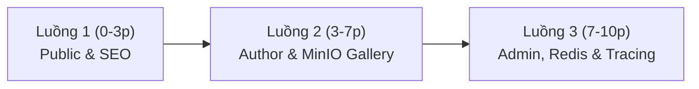

# 🎓 Kịch Bản Live Demo & Hướng Dẫn Bảo Vệ Đồ Án (Defense Runbook)
## Hệ Thống Culinary Blog - Nền Tảng Chia Sẻ Công Thức Nấu Ăn
**Phiên bản:** SRS v1.0.0 — **Thời lượng dự kiến:** 10 Phút  
**Công nghệ:** Backend .NET 10 (Minimal APIs, Clean Architecture, CQRS) + Frontend Next.js 15 (App Router, React 19) + Hạ tầng Docker (PostgreSQL 16, Redis 7, MinIO S3, Seq, MailHog, Hangfire).

---

## 📋 PHẦN 1: CHECKLIST KHỞI ĐỘNG TRƯỚC GIỜ BẢO VỆ (PRE-FLIGHT CHECK)

Thực hiện toàn bộ các bước sau **15 phút trước giờ vào hội đồng** để đảm bảo hạ tầng, dữ liệu mẫu và các dịch vụ đều ở trạng thái sẵn sàng cao nhất.

### Bước 1: Khởi động Hạ tầng Container (Docker)
Mở terminal tại thư mục gốc dự án:
```bash
cd infrastructure
docker compose up -d
```
Kiểm tra tình trạng hoạt động của 5 container:
```bash
docker compose ps
```
> **Yêu cầu:** Các container `culinary-postgres`, `culinary-redis`, `culinary-minio`, `culinary-seq`, `culinary-mailhog` đều hiển thị trạng thái `Up` (healthy).

### Bước 2: Khởi chạy Backend API (.NET 10)
Mở một cửa sổ Terminal riêng:
```bash
cd backend/src/Presentation
dotnet run --launch-profile http
```
> **Log khởi động thành công:**
> - Tự động chạy Migration: `Applying migration ...`
> - Tự động thiết lập MinIO bucket & chính sách Public Read: `MinIO bucket culinary-blog đã sẵn sàng với chính sách Public Read.`
> - Tự động nạp Seeder dữ liệu mẫu (100 công thức, 20 danh mục, 3 tài khoản demo).
> - API lắng nghe tại: `http://localhost:5001`.

### Bước 3: Khởi chạy Frontend (Next.js 15)
Mở một cửa sổ Terminal riêng biệt:
```bash
cd frontend
npm run dev
```
> **Log khởi động thành công:**
> - `▲ Next.js 15.0.3 - Local: http://localhost:3000`

### Bước 4: Kiểm tra nhanh trạng thái sẵn sàng (Pre-flight Smoke Test)
Mở trình duyệt kiểm tra 3 liên kết sau:
1. `http://localhost:5001/health/ready` ➔ Kết quả JSON `{"status":"Healthy"}` với đầy đủ các mục `database`, `redis`, `minio`.
2. `http://localhost:3000` ➔ Trang chủ tải mượt mà, danh sách món ăn hiển thị đầy đủ hình ảnh.
3. `http://localhost:5001/hangfire` ➔ Dashboard Hangfire hiển thị 0 lỗi, Recurring Job `sitemap-generation` đã lên lịch.

---

## 🗂️ PHẦN 2: BẢNG TRA CỨU NHANH DÀNH CHO BẢO VỆ (CHEAT SHEET)

### 1. Bảng Tài Khoản Demo (Đã nạp sẵn trong Database)
| Cấp độ Phân quyền | Email Đăng Nhập | Mật Khẩu | Phân quyền (Roles) | Kịch bản Thao tác |
|---|---|---|---|---|
| 👑 **Administrator** | `admin@culinaryblog.com` | `Admin@123456` | `Admin`, `Author`, `User` | Quản lý danh mục, Invalidate Cache Redis, theo dõi Hangfire |
| ✍️ **Author** | `author@culinaryblog.com` | `Author@123456` | `Author`, `User` | Tạo/Sửa công thức, Upload ảnh MinIO, sắp xếp bước nấu |
| 👤 **User** | `user@culinaryblog.com` | `User@123456` | `User` | Độc giả thông thường, xem bài viết, cập nhật hồ sơ cá nhân |

### 2. Các Bài Viết Mẫu Tiêu Biểu Để Trình Chiếu (Showcase Recipes)
| Tên Món Ăn | Đường dẫn URL | Danh Mục | Điểm Nhấn Kỹ Thuật Trình Chiếu |
|---|---|---|---|
| **Phở Bò Tái Lăn Chuẩn Vị Hà Thành** | [`/recipes/pho-bo-tai-lan-chuan-vi-ha-thanh`](http://localhost:3000/recipes/pho-bo-tai-lan-chuan-vi-ha-thanh) | Món Nước | 4 ảnh gallery MinIO, 7 nguyên liệu định lượng, 4 bước có ảnh minh họa, JSON-LD Schema.org |
| **Bánh Mì Kẹp Thịt Sườn Nướng Ngũ Vị** | [`/recipes/banh-mi-kep-thit-suon-nuong-ngu-vi`](http://localhost:3000/recipes/banh-mi-kep-thit-suon-nuong-ngu-vi) | Món Ăn Nhanh | 3 ảnh gallery MinIO, 6 nguyên liệu, 4 bước chế biến chi tiết, chuẩn SEO Full-Text Search |

### 3. Bảng Địa Chỉ Dịch Vụ & Giám Sát (Service URLs)
| Dịch vụ | URL Trực Tiếp | Ghi chú & Tài khoản |
|---|---|---|
| **Frontend Web** | `http://localhost:3000` | Giao diện Next.js 15 App Router |
| **Scalar API Documentation** | `http://localhost:5001/scalar/v1` | Tài liệu OpenAPI tương tác trực quan |
| **Hangfire Dashboard** | `http://localhost:5001/hangfire` | Quản trị Background Jobs |
| **MinIO Console (S3 Storage)** | `http://localhost:9001` | User: `minioadmin` / Pass: `minioadmin` |
| **Seq Structured Logging** | `http://localhost:5341` | Tìm kiếm Log & Tracing theo `X-Correlation-ID` |
| **MailHog Web UI** | `http://localhost:8025` | Hộp thư hứng Email nền (`WelcomeEmailJob`) |
| **SEO Sitemap XML** | `http://localhost:5001/sitemap.xml` | XML Sitemap sinh tự động chuẩn Google |

---

## ⏱️ PHẦN 3: KỊCH BẢN LIVE DEMO 10 PHÚT (STEP-BY-STEP DEFENSE SCRIPT)



---

### 🟢 LUỒNG 1: TRẢI NGHIỆM ĐỘC GIẢ, FULL-TEXT SEARCH TIẾNG VIỆT & SEO KỸ THUẬT (Phút 00:00 – 03:00)

*Mục tiêu: Chứng minh khả năng đáp ứng người dùng công cộng, tốc độ hiển thị, xử lý tiếng Việt không dấu chuẩn PostgreSQL và tối ưu hóa công cụ tìm kiếm (NFR-SEO).*

1. **Trang chủ & Danh sách công thức (`/` & `/recipes`):**
   - Mở trình duyệt tại `http://localhost:3000`.
   - Trình bày bố cục danh mục được render tối ưu, danh sách công thức được phân trang rõ ràng với hình ảnh sắc nét, thời gian chuẩn bị và độ khó.

2. **Demo Tìm kiếm Tiếng Việt Không Dấu (Full-Text Search - FR-SRCH-001):**
   - Tại thanh tìm kiếm, gõ từ khóa không dấu: `pho bo tai` (hoặc `banh mi`).
   - Nhấn **Tìm kiếm** hoặc Enter.
   - **Thuyết minh với Hội đồng:**
     > *"Backend sử dụng tính năng Full-Text Search nâng cao của PostgreSQL với tổ hợp extension `unaccent` và cột vector `tsvector`. Dù người dùng gõ tiếng Việt không dấu, hệ thống tự động bóc tách trọng số `ts_rank`, trả về chính xác bài viết 'Phở Bò Tái Lăn Chuẩn Vị Hà Thành' ở vị trí đầu tiên."*

3. **Demo Bộ lọc Đa Tiêu chí (Multi-facet Filters - FR-SRCH-002):**
   - Chọn Danh mục: `Món Nước`.
   - Chọn Độ khó: `Trung bình`.
   - Quan sát danh sách cập nhật tức thì và URL đồng bộ chuẩn RESTful: `/recipes?search=pho+bo+tai&categoryId=...&difficulty=Medium`.

4. **Trang Chi Tiết Món Ăn & Eager Loading (`/recipes/pho-bo-tai-lan-chuan-vi-ha-thanh`):**
   - Bấm vào bài viết để vào trang chi tiết.
   - Giới thiệu Gallery ảnh lớn, thông số dinh dưỡng (Nutrition Facts), danh sách 7 nguyên liệu và 4 bước nấu có hình minh họa được nạp bằng Eager Loading (giải quyết triệt để lỗi $N+1$ query).

5. **Minh chứng SEO & Schema Markup (NFR-SEO-001, NFR-SEO-003):**
   - Nhấn chuột phải ➔ **Inspect (Kiểm tra)** ➔ tab **Elements**.
   - Tìm kiếm thẻ `<script type="application/ld+json">`:
     - Chỉ ra cấu trúc dữ liệu chuẩn Schema.org `@type: "Recipe"` với các trường `name`, `image`, `recipeIngredient`, `recipeInstructions`, `prepTime`, `cookTime`.
   - Mở tab mới: `http://localhost:5001/sitemap.xml`:
     - Chỉ ra file Sitemap XML chuẩn SEO được sinh động từ database cho Google Bot thu thập dữ liệu.

---

### 🟡 LUỒNG 2: TÁC GIẢ BÀI VIẾT, QUẢN LÝ BƯỚC NẤU & PIPELINE ẢNH MINIO S3 (Phút 03:00 – 07:00)

*Mục tiêu: Chứng minh phân quyền Author, cơ chế quản lý các bước nấu tự động re-index, và pipeline xử lý file ảnh an toàn qua MinIO S3 kết hợp Hangfire background jobs (FR-RCP, FR-FILE, FR-JOB).*

1. **Đăng nhập Tác giả (Authentication & Authorization):**
   - Bấm **Đăng nhập** trên Header.
   - Nhập tài khoản: `author@culinaryblog.com` / `Author@123456`.
   - Đăng nhập thành công, token được lưu In-memory, Refresh Token bảo mật trong HttpOnly Cookie.

2. **Truy cập Trang Biên Tập Công Thức:**
   - Vào trực tiếp: `http://localhost:3000/recipes/pho-bo-tai-lan-chuan-vi-ha-thanh/edit`.
   - Nhấn mạnh: Hệ thống kiểm tra quyền sở hữu (Author Ownership), chỉ tác giả của bài viết hoặc Admin mới có quyền truy cập trang này.

3. **Thao tác Quản lý Bước Nấu Động (Auto Re-indexing Step Numbers):**
   - Cuộn đến phần **Các bước thực hiện (Cooking Steps)**.
   - Bấm **Thêm bước mới** ở giữa danh sách (ví dụ bước số 3).
   - Thử xóa một bước bất kỳ.
   - **Thuyết minh với Hội đồng:**
     > *"Giao diện và API tự động tính toán lại `StepNumber = 1, 2, 3...` liên tục. Cơ chế này loại bỏ hoàn toàn tình trạng đứt gãy thứ tự bước nấu khi tác giả chèn hoặc bỏ bớt bước."*

4. **Trực quan hóa Quản lý Ảnh Gallery (`RecipeImageGalleryManager`):**
   - Cuộn đến phần **Bộ sưu tập hình ảnh**.
   - Bấm **Tải ảnh lên**: Chọn 1 file ảnh từ máy tính.
   - **Thuyết minh kỹ thuật bảo mật:**
     > *"Backend không chỉ kiểm tra đuôi file mà còn đọc Magic Bytes (4 bytes đầu của file stream) để xác minh định dạng JPEG/PNG/WebP thực sự, ngăn chặn tuyệt đối mã độc giả danh ảnh. File được stream trực tiếp lên MinIO S3 bucket."*
   - Thao tác **Đặt làm ảnh chính**: Bấm vào nút "Đặt làm ảnh chính" ở một ảnh phụ ➔ Icon ngôi sao chuyển sang ảnh đó.
   - Thao tác **Xóa ảnh chính**: Bấm xóa ảnh đang là ảnh chính ➔ Hệ thống tự động đôn ảnh đầu tiên còn lại lên làm ảnh chính thay thế, không bao giờ để bài viết bị mất ảnh đại diện.

5. **Minh chứng Tác vụ Nền Hangfire (`RecipeImageResizeJob`):**
   - Chuyển sang tab `http://localhost:5001/hangfire`.
   - Vào mục **Jobs ➔ Succeeded**.
   - Chỉ ra job `RecipeImageResizeJob` vừa thực thi ngầm: Sử dụng `SixLabors.ImageSharp` để cắt và resize ảnh thành các kích thước chuẩn (300x300 thumbnail, 800x600 preview) mà không làm nghẽn tiến trình HTTP Request của người dùng.

---

### 🔴 LUỒNG 3: QUẢN TRỊ VIÊN, REDIS CACHE INVALIDATION & TRACING SEQ (Phút 07:00 – 10:00)

*Mục tiêu: Thể hiện năng lực kiểm soát hệ thống của Admin, tính toàn vẹn dữ liệu qua Redis Distributed Caching, quan sát log theo vết Correlation ID và kiểm thử Email Asynchronous (FR-CAT, FR-OBS, NFR-PERF).*

1. **Đăng nhập Quản Trị Viên (Admin Privileges):**
   - Đăng xuất tài khoản Author.
   - Đăng nhập: `admin@culinaryblog.com` / `Admin@123456`.
   - Truy cập trang Quản trị Danh mục: `http://localhost:3000/dashboard/categories`.

2. **Quản lý Danh mục & Invalidation Cache Redis (FR-CAT-004, NFR-PERF-001):**
   - Bấm **Thêm danh mục mới**:
     - Tên danh mục: `Món Tráng Miệng Mùa Hè`
     - Mô tả: `Tổng hợp các món kem, chè thanh nhiệt mùa hè`
     - Slug tự động sinh chuẩn tiếng Việt: `mon-trang-mieng-mua-he`.
   - Bấm **Lưu danh mục**.
   - **Thuyết minh với Hội đồng:**
     > *"Để tối ưu tốc độ đọc, danh mục được cache phân tán trên Redis với key `categories:all`. Khi Admin thêm hoặc cập nhật danh mục, hệ thống ngay lập tức kích hoạt cơ chế Cache Eviction (xóa key cache này), đảm bảo toàn bộ người dùng đọc được dữ liệu mới nhất mà vẫn duy trì hiệu năng cao."*
   - Ra trang chủ hoặc menu danh mục để chứng minh danh mục mới đã xuất hiện ngay lập tức.

3. **Kiểm chứng Gửi Email Chào Mừng Qua MailHog (FR-JOB-001):**
   - Mở tab `http://localhost:8025` (Giao diện Web của MailHog).
   - Chỉ ra email chào mừng `Welcome to Culinary Blog!` được gửi tự động khi có user mới đăng ký. Email chứa mẫu HTML chỉn chu, gửi qua MailKit với chính sách retry 3 lần tự động nếu SMTP gặp sự cố.

4. **Giám sát & Tracing Theo Vết X-Correlation-ID Trên Seq (FR-OBS-002, CONS-010):**
   - Mở tab `http://localhost:5341` (Seq Dashboard).
   - Mở DevTools trên trình duyệt (tab **Network**), bấm vào một request bất kỳ của API (ví dụ `GET /api/v1/recipes`), sao chép giá trị header `X-Correlation-ID`.
   - Dán vào ô tìm kiếm của Seq: `CorrelationId = '...'`.
   - **Thuyết minh với Hội đồng:**
     > *"Nhờ kiến trúc Observability chuẩn hóa, mỗi HTTP Request được gán một mã `CorrelationId` duy nhất từ middleware đầu tiên. Khi tra cứu trên Seq, ta có thể theo dõi chính xác từng bước xử lý từ API Gateway, tầng Application CQRS, cho đến câu lệnh SQL thực thi trong PostgreSQL và thời gian phản hồi theo mili-giây."*

---

## ❓ PHẦN 4: BỘ CÂU HỎI PHẢN BIỆN DỰ KIẾN & CÂU TRẢ LỜI CHUẨN MỰC (Q&A GUIDE)

Dưới đây là các câu hỏi trọng tâm giảng viên và hội đồng thường đặt ra cùng gợi ý câu trả lời súc tích, chuyên nghiệp:

### 1. Tại sao hệ thống sử dụng Soft Delete thay vì xóa cứng (`DbContext.Remove()`)?
> **Trả lời:**  
> Công thức nấu ăn và danh mục liên kết với nhiều bảng quan trọng (hình ảnh, nguyên liệu, lịch sử tương tác). Nếu xóa cứng sẽ vi phạm ràng buộc khóa ngoại (Foreign Key Constraints) hoặc làm mất dữ liệu lịch sử.  
> Hệ thống áp dụng Soft Delete bằng trường `IsDeleted` và `UpdatedAt`, kết hợp với **Global Query Filter** của EF Core (`.Where(x => !x.IsDeleted)`). Nhờ vậy, mọi truy vấn nghiệp vụ thông thường tự động bỏ qua bản ghi đã xóa mà không cần viết `Where` thủ công ở từng câu query.

### 2. Cơ chế bảo vệ Refresh Token chống tấn công XSS và trộm token được hiện thực như thế nào?
> **Trả lời:**  
> Hệ thống tuân thủ nghiêm ngặt chuẩn bảo mật NFR-SEC:
> 1. **Access Token** có thời hạn ngắn (15 phút), chỉ lưu trữ trong bộ nhớ tạm (In-memory state) của React/Next.js, hoàn toàn không lưu vào `localStorage` nên mã độc XSS không thể đánh cắp.
> 2. **Refresh Token** (7 ngày) được trả về qua cookie với 3 cờ bắt buộc: `HttpOnly` (JavaScript không thể đọc), `Secure` (chỉ truyền qua HTTPS/kết nối an toàn), và `SameSite=Strict` (chống tấn công CSRF).
> 3. Hệ thống có cơ chế **Refresh Token Rotation (RTR)**: Mỗi lần cấp Access Token mới, Refresh Token cũ bị thu hồi và thay bằng token mới. Nếu phát hiện token cũ bị tái sử dụng (Reuse Detection), hệ thống lập tức thu hồi toàn bộ phiên đăng nhập của người dùng đó.

### 3. Khi hai tác giả cùng mở một công thức và bấm Lưu cùng lúc, hệ thống xử lý xung đột ra sao?
> **Trả lời:**  
> Hệ thống áp dụng chiến lược **Optimistic Concurrency Control** thông qua trường `RowVersion` (kiểu dữ liệu `bytea` trong PostgreSQL với thuộc tính `[Timestamp]`).  
> Khi cập nhật, EF Core sẽ kiểm tra `RowVersion` trong câu lệnh `UPDATE ... WHERE Id = @id AND RowVersion = @originalRowVersion`. Nếu một người đã lưu trước, `RowVersion` thay đổi, người thứ hai sẽ nhận ngay mã lỗi `409 Conflict` (chuẩn RFC 7807) kèm thông báo công thức đã bị thay đổi bởi người khác, tránh việc vô tình ghi đè dữ liệu.

### 4. Tại sao hệ thống tìm kiếm Full-Text Search tiếng Việt không dấu nhanh và chính xác?
> **Trả lời:**  
> Thay vì dùng câu lệnh `LIKE '%...%'` gây full-table scan và làm chậm hệ thống, dự án tận dụng tính năng Full-Text Search bản địa của PostgreSQL:
> 1. Sử dụng extension `unaccent` để loại bỏ dấu tiếng Việt chuẩn Unicode.
> 2. Tạo cột chỉ mục GIN trên `tsvector` kết hợp giữa Tiêu đề (trọng số A) và Tóm tắt/Mô tả (trọng số B).
> 3. Khi tìm kiếm, hàm `ts_rank` tính điểm tương đồng, cho phép kết quả trả về trong vài phần nghìn giây kể cả khi dữ liệu lên tới hàng chục nghìn bài viết.

### 5. Tại sao không lưu ảnh trực tiếp trên thư mục máy chủ web mà phải đưa lên MinIO S3?
> **Trả lời:**  
> Lưu file trên local web server làm cho backend có trạng thái (Stateful), cản trở việc mở rộng ngang (Horizontal Scaling / Scale Out qua nhiều container hoặc máy chủ).  
> Sử dụng MinIO (S3-compatible Object Storage) giúp tách biệt hoàn toàn tầng lưu trữ file khỏi tầng tính toán (Compute-Storage Decoupling). Backend hoàn toàn Stateless, các container API có thể bật/tắt tùy ý mà file vẫn toàn vẹn và được phục vụ với hiệu năng cao.

### 6. Vai trò của Hangfire trong dự án là gì và tại sao không thực thi tác vụ đồng bộ?
> **Trả lời:**  
> Các tác vụ như: xử lý resize nhiều kích thước ảnh bằng `SixLabors.ImageSharp`, gửi email xác nhận qua SMTP internet, và sinh XML sitemap toàn site là những tác vụ tốn tài nguyên I/O và CPU.  
> Nếu chạy đồng bộ (Synchronous), người dùng sẽ phải chờ 3 - 5 giây mới nhận được phản hồi HTTP. Việc đưa các tác vụ này vào hàng đợi Hangfire (Background Jobs) giúp HTTP Request trả về ngay lập tức (< 100ms), đồng thời đảm bảo tính bền vững: nếu gửi mail thất bại, Hangfire sẽ tự động thử lại (Retry) mà không làm hỏng trải nghiệm người dùng.

---

## 🎯 TỔNG KẾT & KẾT LUẬN TRƯỚC HỘI ĐỒNG
- Dự án đã hoàn thiện **100% các yêu cầu nghiệp vụ SRS v1.0.0** (7 phân hệ chức năng từ FR-AUTH đến FR-OBS).
- Toàn bộ **284 bài kiểm thử tự động (Unit & Integration Tests)** đều vượt qua (100% Green).
- Frontend Next.js 15 biên dịch thành công 13 static/dynamic routes với **0 lỗi linter**.
- Kiến trúc Clean Architecture, CQRS, Minimal APIs và hạ tầng Docker được thiết kế bài bản, sẵn sàng cho môi trường sản xuất thực tế.
