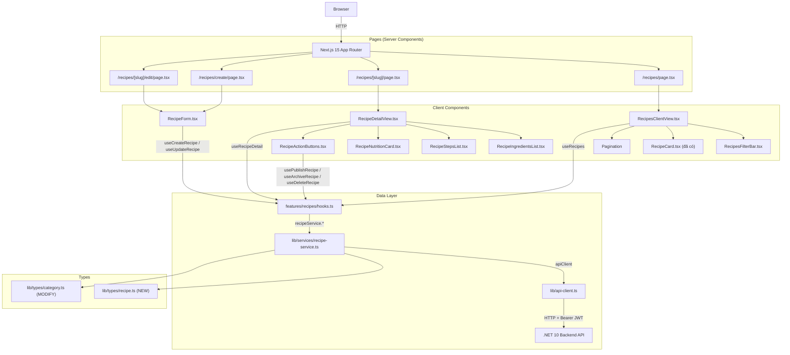

# Kế hoạch Triển khai Frontend Module Recipe (Lab 5)

> **Tác giả:** Nguyễn Thành Minh — MSSV 2312691  
> **Nhánh làm việc:** `2312691/NguyenThanhMinh/lab5-frontend-recipe`  
> **Ngày lập:** 06/10/2026  
> **Phạm vi:** Xây dựng toàn bộ tầng Frontend (Next.js 15 App Router) cho Module Quản lý Công thức Nấu ăn (FR-RCP-001 → FR-RCP-007) theo nguyên tắc Vertical Slice được giao.

---

## Mục tiêu

Backend đã hoàn thiện 100% (8 endpoints, CQRS handlers, validation, caching). Công việc tiếp theo là **hoàn thiện tầng Frontend** để kết nối với Backend API đã xây dựng, theo đúng nguyên tắc **Vertical Slice** được phân công trong đồ án.

### Cần hoàn thành:
1. TypeScript types khớp chính xác với Backend DTOs
2. Recipe API service client (dùng `apiClient` đã có)
3. React Query hooks cho mọi thao tác Recipe
4. Trang danh sách công thức (`/recipes`) — có filter, sort, phân trang
5. Trang chi tiết công thức (`/recipes/[slug]`) — hiển thị đầy đủ Steps, Ingredients, Nutrition, Images
6. Trang tạo công thức mới (`/recipes/create`) — form + validation
7. Trang chỉnh sửa công thức (`/recipes/[slug]/edit`) — form + Publish/Unpublish/Archive/Delete
8. NFR-SEO cơ bản: `generateMetadata` động và JSON-LD Schema.org Recipe

---

## Kiến trúc & Phân tích Codebase Hiện Tại

### Codebase Frontend đang có:
```
frontend/src/
├── app/
│   ├── layout.tsx            ✅ RootLayout với <Providers> & <SiteHeader>
│   ├── recipes/
│   │   ├── page.tsx          ⚠️  Stub — chỉ có 1 dòng placeholder
│   │   └── [slug]/
│   │       └── page.tsx      ⚠️  Stub — chỉ có 1 dòng placeholder
│   ├── login/ register/ profile/  ✅ Đã có (Thành viên Hiếu)
│   └── categories/           ✅ Đã có (Thành viên Phước)
├── components/
│   ├── recipes/
│   │   └── RecipeCard.tsx    ✅ Đã có — dùng RecipeSummaryDto
│   ├── categories/           ✅ Đã có
│   └── site-header.tsx       ✅ Đã có
├── features/
│   └── auth/                 ✅ Đã có (api.ts, hooks.ts, types.ts, token-store.ts)
└── lib/
    ├── api-client.ts          ✅ Đã có — apiClient<T> + authHeaders
    ├── services/
    │   └── category-service.ts  ✅ Mẫu để viết recipe-service.ts
    └── types/
        └── category.ts       ✅ Đã có RecipeSummaryDto (cần mở rộng thêm)
```

### Dependencies đã cài sẵn (package.json):
- `@tanstack/react-query` v5 ✅
- `react-hook-form` + `@hookform/resolvers` + `zod` ✅
- `next` 15.0.3 (App Router) ✅
- `tailwindcss` ✅
- `lucide-react` ✅

### Backend DTOs cần map:

**RecipeSummaryDto** (dùng cho danh sách):
```typescript
// Mapping từ backend/Application/Features/Recipes/DTOs/RecipeSummaryDto.cs
{
  id: string;           // Guid
  title: string;
  slug: string;
  description: string;
  totalTimeMinutes: number;  // PrepTime + CookTime (gộp sẵn ở backend)
  servings: number;
  difficulty: number;   // enum RecipeDifficulty: 1=Easy, 2=Medium, 3=Hard, 4=Expert
  status: string;       // enum RecipeStatus: "Draft" | "Published" | "Archived"
  categoryName: string;
  authorId: string;
  authorName: string;
  createdAt: string;
  thumbnailUrl: string | null;
}
```

**RecipeDetailDto** (dùng cho chi tiết):
```typescript
// Mapping từ backend/Application/Features/Recipes/DTOs/RecipeDetailDto.cs
{
  id, title, slug, description, instructions,
  prepTimeMinutes, cookTimeMinutes, servings,
  difficulty, status, categoryId, categoryName,
  authorId, authorName, createdAt, updatedAt, publishedAt,
  nutrition: { calories, protein, carbohydrates, fat },
  steps: [{ id, stepNumber, title, description, timerMinutes, imageUrl }],
  ingredients: [{ id, name, quantity, unit, notes, orderIndex }],
  images: [{ id, originalUrl, mediumUrl, thumbnailUrl, altText, isPrimary, orderIndex }]
}
```

> [!IMPORTANT]
> `RecipeSummaryDto.cs` trong backend dùng `TotalTimeMinutes` (đã gộp prepTime + cookTime) thay vì 2 trường riêng. Cần cập nhật type trong `category.ts` và `RecipeCard.tsx` cho khớp.

---

## Giai đoạn 1 — TypeScript Types & API Service (Ưu tiên cao nhất)

**Nhánh:** `2312691/NguyenThanhMinh/lab5-frontend-recipe`  
**Ước lượng:** ~2–3 giờ

### Danh sách file cần tạo/sửa

---

#### [MODIFY] `frontend/src/lib/types/category.ts`

Cập nhật `RecipeSummaryDto` cho khớp chính xác với Backend DTO mới (`totalTimeMinutes` thay vì `prepTime + cookTime`):

```typescript
// Thêm các type còn thiếu
export type RecipeStatus = 'Draft' | 'Published' | 'Archived';
export type RecipeDifficulty = 1 | 2 | 3 | 4; // Easy / Medium / Hard / Expert

// Cập nhật RecipeSummaryDto — khớp với RecipeSummaryDto.cs
export interface RecipeSummaryDto {
  id: string;
  title: string;
  slug: string;
  description: string;
  totalTimeMinutes: number;   // ← đổi từ prepTime+cookTime sang trường gộp
  servings: number;
  difficulty: RecipeDifficulty;
  status: RecipeStatus;
  categoryName: string;
  authorId: string;
  authorName: string;
  createdAt: string;
  thumbnailUrl: string | null;
}
```

---

#### [NEW] `frontend/src/lib/types/recipe.ts`

```typescript
import type { RecipeDifficulty, RecipeStatus } from './category';

// --- Detail DTOs ---
export interface RecipeNutritionDto {
  calories: number | null;
  protein: number | null;
  carbohydrates: number | null;
  fat: number | null;
}

export interface RecipeStepDto {
  id: string;
  stepNumber: number;
  title: string;
  description: string;
  timerMinutes: number | null;
  imageUrl: string | null;
}

export interface RecipeIngredientDto {
  id: string;
  name: string;
  quantity: number | null;
  unit: string | null;
  notes: string | null;
  orderIndex: number;
}

export interface RecipeImageDto {
  id: string;
  originalUrl: string;
  mediumUrl: string | null;
  thumbnailUrl: string | null;
  altText: string | null;
  isPrimary: boolean;
  orderIndex: number;
}

export interface RecipeDetailDto {
  id: string;
  title: string;
  slug: string;
  description: string;
  instructions: string;
  prepTimeMinutes: number;
  cookTimeMinutes: number;
  servings: number;
  difficulty: RecipeDifficulty;
  status: RecipeStatus;
  categoryId: string;
  categoryName: string;
  authorId: string;
  authorName: string;
  createdAt: string;
  updatedAt: string | null;
  publishedAt: string | null;
  nutrition: RecipeNutritionDto;
  steps: RecipeStepDto[];
  ingredients: RecipeIngredientDto[];
  images: RecipeImageDto[];
}

// --- RecipeDto (trả về sau Create/Update) ---
export interface RecipeDto {
  id: string;
  title: string;
  slug: string;
  status: RecipeStatus;
  createdAt: string;
}

// --- Request types (gửi lên Backend) ---
export interface CreateRecipeRequest {
  title: string;
  description: string;
  instructions: string;
  prepTimeMinutes: number;
  cookTimeMinutes: number;
  servings: number;
  difficulty: RecipeDifficulty;
  categoryId: string;
  calories: number;
  protein: number;
  carbs: number;
  fat: number;
}

export interface UpdateRecipeRequest extends CreateRecipeRequest {
  id: string;
  rowVersion: string; // Concurrency token
}

// --- Query params ---
export interface GetRecipesParams {
  searchTerm?: string;
  categoryId?: string;
  difficulty?: RecipeDifficulty;
  maxTotalTimeMinutes?: number;
  sortBy?: 'newest' | 'oldest' | 'time_asc' | 'time_desc';
  page?: number;
  pageSize?: number;
}
```

---

#### [NEW] `frontend/src/lib/services/recipe-service.ts`

```typescript
import { apiClient } from '@/lib/api-client';
import { authHeaders } from '@/features/auth/token-store';
import type { RecipeDetailDto, RecipeDto, CreateRecipeRequest, UpdateRecipeRequest, GetRecipesParams } from '@/lib/types/recipe';
import type { RecipeSummaryDto, PagedResult } from '@/lib/types/category';

function withAuth(init: { method?: string; body?: string } = {}): RequestInit {
  return { ...init, headers: { ...authHeaders() } };
}

export const recipeService = {
  /** FR-RCP-001: GET /recipes — danh sách phân trang, lọc, sắp xếp */
  async getRecipes(params: GetRecipesParams = {}): Promise<PagedResult<RecipeSummaryDto>> {
    const qs = new URLSearchParams();
    if (params.searchTerm)       qs.set('searchTerm', params.searchTerm);
    if (params.categoryId)       qs.set('categoryId', params.categoryId);
    if (params.difficulty)       qs.set('difficulty', String(params.difficulty));
    if (params.maxTotalTimeMinutes) qs.set('maxTotalTimeMinutes', String(params.maxTotalTimeMinutes));
    if (params.sortBy)           qs.set('sortBy', params.sortBy);
    qs.set('page',     String(params.page     ?? 1));
    qs.set('pageSize', String(params.pageSize ?? 12));
    return apiClient<PagedResult<RecipeSummaryDto>>(`/recipes?${qs}`);
  },

  /** FR-RCP-002: GET /recipes/{slug} — chi tiết theo slug */
  async getRecipeBySlug(slug: string): Promise<RecipeDetailDto> {
    return apiClient<RecipeDetailDto>(`/recipes/${encodeURIComponent(slug)}`);
  },

  /** FR-RCP-003: POST /recipes — tạo mới (Draft) */
  async createRecipe(data: CreateRecipeRequest): Promise<RecipeDto> {
    return apiClient<RecipeDto>('/recipes', withAuth({ method: 'POST', body: JSON.stringify(data) }));
  },

  /** FR-RCP-004: PUT /recipes/{id} — cập nhật thông tin */
  async updateRecipe(id: string, data: UpdateRecipeRequest): Promise<RecipeDto> {
    return apiClient<RecipeDto>(`/recipes/${id}`, withAuth({ method: 'PUT', body: JSON.stringify(data) }));
  },

  /** FR-RCP-005: PATCH /recipes/{id}/publish */
  async publishRecipe(id: string): Promise<RecipeDto> {
    return apiClient<RecipeDto>(`/recipes/${id}/publish`, withAuth({ method: 'PATCH' }));
  },

  /** FR-RCP-005: PATCH /recipes/{id}/unpublish */
  async unpublishRecipe(id: string): Promise<RecipeDto> {
    return apiClient<RecipeDto>(`/recipes/${id}/unpublish`, withAuth({ method: 'PATCH' }));
  },

  /** FR-RCP-006: PATCH /recipes/{id}/archive */
  async archiveRecipe(id: string): Promise<RecipeDto> {
    return apiClient<RecipeDto>(`/recipes/${id}/archive`, withAuth({ method: 'PATCH' }));
  },

  /** FR-RCP-007: DELETE /recipes/{id} — soft delete (204 No Content) */
  async deleteRecipe(id: string): Promise<void> {
    return apiClient<void>(`/recipes/${id}`, withAuth({ method: 'DELETE' }));
  },
};
```

---

#### [NEW] `frontend/src/features/recipes/hooks.ts`

```typescript
'use client';
import { useMutation, useQuery, useQueryClient } from '@tanstack/react-query';
import { recipeService } from '@/lib/services/recipe-service';
import type { GetRecipesParams } from '@/lib/types/recipe';

export const recipeKeys = {
  all: ['recipes'] as const,
  lists: () => [...recipeKeys.all, 'list'] as const,
  list: (params: GetRecipesParams) => [...recipeKeys.lists(), params] as const,
  detail: (slug: string) => [...recipeKeys.all, 'detail', slug] as const,
};

export function useRecipes(params: GetRecipesParams = {}) {
  return useQuery({
    queryKey: recipeKeys.list(params),
    queryFn: () => recipeService.getRecipes(params),
    staleTime: 5 * 60 * 1000,
  });
}

export function useRecipeDetail(slug: string) {
  return useQuery({
    queryKey: recipeKeys.detail(slug),
    queryFn: () => recipeService.getRecipeBySlug(slug),
    enabled: !!slug,
    staleTime: 5 * 60 * 1000,
  });
}

export function useCreateRecipe() {
  const qc = useQueryClient();
  return useMutation({
    mutationFn: recipeService.createRecipe,
    onSuccess: () => qc.invalidateQueries({ queryKey: recipeKeys.lists() }),
  });
}

export function useUpdateRecipe(id: string) {
  const qc = useQueryClient();
  return useMutation({
    mutationFn: (data: Parameters<typeof recipeService.updateRecipe>[1]) =>
      recipeService.updateRecipe(id, data),
    onSuccess: () => qc.invalidateQueries({ queryKey: recipeKeys.all }),
  });
}

export function usePublishRecipe() {
  const qc = useQueryClient();
  return useMutation({
    mutationFn: recipeService.publishRecipe,
    onSuccess: () => qc.invalidateQueries({ queryKey: recipeKeys.all }),
  });
}

export function useUnpublishRecipe() {
  const qc = useQueryClient();
  return useMutation({
    mutationFn: recipeService.unpublishRecipe,
    onSuccess: () => qc.invalidateQueries({ queryKey: recipeKeys.all }),
  });
}

export function useArchiveRecipe() {
  const qc = useQueryClient();
  return useMutation({
    mutationFn: recipeService.archiveRecipe,
    onSuccess: () => qc.invalidateQueries({ queryKey: recipeKeys.all }),
  });
}

export function useDeleteRecipe() {
  const qc = useQueryClient();
  return useMutation({
    mutationFn: recipeService.deleteRecipe,
    onSuccess: () => qc.invalidateQueries({ queryKey: recipeKeys.all }),
  });
}
```

---

## Giai đoạn 2 — Trang Danh Sách Công Thức (`/recipes`)

**Ưu tiên:** Cao  
**Ước lượng:** ~3–4 giờ

### Mục tiêu:
- Hiển thị danh sách công thức dạng Grid (3 cột)
- Bộ lọc: Tìm kiếm (searchTerm), Danh mục (categoryId), Độ khó, Thời gian tối đa
- Sắp xếp: Mới nhất / Cũ nhất / Nhanh nhất / Chậm nhất
- Phân trang theo `page` / `pageSize`
- Tái sử dụng `RecipeCard.tsx` đã có

### Luồng dữ liệu:
```
/recipes?page=1&categoryId=...&difficulty=1&sortBy=newest
   → RecipesPage (Server Component, đọc searchParams)
      → RecipesClientView (Client Component)
         → useRecipes(params) [React Query]
            → recipeService.getRecipes(params)
               → GET /api/v1/recipes?...
                  → PagedResult<RecipeSummaryDto>
         → RecipeCard (mỗi item)
         → RecipesFilterBar (bộ lọc, cập nhật URL)
         → RecipesPagination (điều hướng trang)
```

### Danh sách file cần tạo:

#### [MODIFY] `frontend/src/app/recipes/page.tsx`
Chuyển từ stub sang Server Component nhận `searchParams`, render `<RecipesClientView>`.

#### [NEW] `frontend/src/components/recipes/RecipesClientView.tsx`
Client Component chứa logic fetch + render danh sách + filter + pagination.

#### [NEW] `frontend/src/components/recipes/RecipesFilterBar.tsx`
Bộ lọc: input tìm kiếm, dropdown danh mục, dropdown độ khó, slider thời gian, dropdown sắp xếp. Cập nhật URL params bằng `useRouter().push()`.

#### [MODIFY] `frontend/src/components/recipes/RecipeCard.tsx`
Cập nhật prop từ `prepTime + cookTime` sang `totalTimeMinutes` (khớp DTO mới từ backend).

---

## Giai đoạn 3 — Trang Chi Tiết Công Thức (`/recipes/[slug]`)

**Ưu tiên:** Cao  
**Ước lượng:** ~4–5 giờ

### Mục tiêu:
- Hiển thị đầy đủ: Tiêu đề, Mô tả, Thông tin thời gian, Danh mục, Tác giả, Hình ảnh
- Danh sách Nguyên liệu (`RecipeIngredientDto[]`)
- Các bước thực hiện (`RecipeStepDto[]`) — có timer
- Bảng thông tin dinh dưỡng (`RecipeNutritionDto`)
- Nút thao tác cho Owner/Admin: Sửa, Publish/Unpublish, Archive, Xóa
- `generateMetadata()` động cho SEO
- JSON-LD Schema.org Recipe nhúng vào `<head>`
- Xử lý quyền truy cập: `403` khi xem Draft mà không phải owner

### Danh sách file cần tạo:

#### [MODIFY] `frontend/src/app/recipes/[slug]/page.tsx`
```typescript
// Server Component với generateMetadata + JSON-LD
export async function generateMetadata({ params }) {
  const recipe = await recipeService.getRecipeBySlug(params.slug);
  return {
    title: `${recipe.title} | Culinary Blog`,
    description: recipe.description,
    openGraph: { images: [recipe.images[0]?.thumbnailUrl] }
  };
}
```

#### [NEW] `frontend/src/components/recipes/RecipeDetailView.tsx`
Client Component hiển thị chi tiết đầy đủ của công thức.

#### [NEW] `frontend/src/components/recipes/RecipeIngredientsList.tsx`
Hiển thị danh sách nguyên liệu theo `orderIndex`.

#### [NEW] `frontend/src/components/recipes/RecipeStepsList.tsx`
Hiển thị các bước theo `stepNumber`, có countdown timer tương tác.

#### [NEW] `frontend/src/components/recipes/RecipeNutritionCard.tsx`
Bảng dinh dưỡng dạng card (Calories, Protein, Carbs, Fat).

#### [NEW] `frontend/src/components/recipes/RecipeActionButtons.tsx`
Nút thao tác cho Author/Admin: Publish, Unpublish, Archive, Xóa (có confirm modal).

---

## Giai đoạn 4 — Form Tạo & Chỉnh Sửa Công Thức

**Ưu tiên:** Trung bình - Cao  
**Ước lượng:** ~5–6 giờ

### Mục tiêu:
- Form tạo mới công thức tại `/recipes/create`
- Form chỉnh sửa tại `/recipes/[slug]/edit`
- Validation client-side với Zod schema (khớp với backend FluentValidation)
- Hiển thị lỗi server dạng inline (giống CategoryFormModal.tsx)
- Chọn danh mục từ dropdown (tái dùng `categoryService.getCategories()`)

### Zod Schema:

```typescript
// frontend/src/features/recipes/schemas.ts
import { z } from 'zod';

export const recipeSchema = z.object({
  title:            z.string().min(5, 'Tiêu đề tối thiểu 5 ký tự').max(200),
  description:      z.string().min(10, 'Mô tả tối thiểu 10 ký tự').max(2000),
  instructions:     z.string().min(10, 'Hướng dẫn tối thiểu 10 ký tự'),
  categoryId:       z.string().uuid('Vui lòng chọn danh mục'),
  prepTimeMinutes:  z.coerce.number().min(1, 'Thời gian chuẩn bị tối thiểu 1 phút'),
  cookTimeMinutes:  z.coerce.number().min(1, 'Thời gian nấu tối thiểu 1 phút'),
  servings:         z.coerce.number().min(1, 'Số khẩu phần tối thiểu 1'),
  difficulty:       z.coerce.number().min(1).max(4),
  calories:         z.coerce.number().min(0).default(0),
  protein:          z.coerce.number().min(0).default(0),
  carbs:            z.coerce.number().min(0).default(0),
  fat:              z.coerce.number().min(0).default(0),
});

export type RecipeFormData = z.infer<typeof recipeSchema>;
```

### Danh sách file cần tạo:

#### [NEW] `frontend/src/features/recipes/schemas.ts`
Zod schema cho form tạo/chỉnh sửa công thức.

#### [NEW] `frontend/src/app/recipes/create/page.tsx`
Trang tạo mới — yêu cầu đăng nhập (redirect về `/login` nếu chưa).

#### [NEW] `frontend/src/app/recipes/[slug]/edit/page.tsx`
Trang chỉnh sửa — yêu cầu đăng nhập + là owner hoặc Admin.

#### [NEW] `frontend/src/components/recipes/RecipeForm.tsx`
Form dùng chung cho cả tạo mới và chỉnh sửa. Props: `defaultValues`, `onSubmit`, `isSubmitting`.

---

## Giai đoạn 5 — NFR-SEO & Tối ưu (Phụ trách cùng Trần Ngọc Bảo Phước)

**Ưu tiên:** Trung bình  
**Ước lượng:** ~2–3 giờ  
**Tuần:** 6–7

### Mục tiêu:
- JSON-LD Schema.org Recipe cho trang chi tiết
- `generateMetadata()` đầy đủ (title, description, og:image, og:type)
- Canonical URL tránh duplicate content

### JSON-LD Recipe Schema (nhúng vào `[slug]/page.tsx`):

```typescript
// Component <RecipeJsonLd recipe={recipe} />
const jsonLd = {
  '@context': 'https://schema.org',
  '@type': 'Recipe',
  name: recipe.title,
  description: recipe.description,
  author: { '@type': 'Person', name: recipe.authorName },
  datePublished: recipe.publishedAt,
  prepTime: `PT${recipe.prepTimeMinutes}M`,
  cookTime: `PT${recipe.cookTimeMinutes}M`,
  totalTime: `PT${recipe.prepTimeMinutes + recipe.cookTimeMinutes}M`,
  recipeYield: `${recipe.servings} phần`,
  image: recipe.images.filter(i => i.isPrimary).map(i => i.originalUrl),
  recipeIngredient: recipe.ingredients.map(i => `${i.quantity ?? ''} ${i.unit ?? ''} ${i.name}`.trim()),
  recipeInstructions: recipe.steps.map(s => ({
    '@type': 'HowToStep',
    name: s.title,
    text: s.description,
  })),
  nutrition: recipe.nutrition.calories ? {
    '@type': 'NutritionInformation',
    calories: `${recipe.nutrition.calories} calories`,
  } : undefined,
};
```

---

## Sơ đồ Kiến trúc Tổng Thể



---

## Kế hoạch Chi tiết Theo Tuần

| Giai đoạn | Nội dung | Ước lượng | Nhánh commit |
| :--- | :--- | :--- | :--- |
| **Giai đoạn 1** | Types + recipe-service.ts + hooks.ts | 2–3 giờ | `feat(recipe): add ts types and api service` |
| **Giai đoạn 2** | Trang danh sách `/recipes` + filter + pagination | 3–4 giờ | `feat(recipe): implement recipes list page` |
| **Giai đoạn 3** | Trang chi tiết `/recipes/[slug]` | 4–5 giờ | `feat(recipe): implement recipe detail page` |
| **Giai đoạn 4** | Form tạo/chỉnh sửa + Publish/Archive/Delete buttons | 5–6 giờ | `feat(recipe): add create and edit forms` |
| **Giai đoạn 5** | JSON-LD SEO + generateMetadata | 2–3 giờ | `feat(seo): add JSON-LD schema and metadata for recipes` |

---

## Quy tắc Coding tuân thủ trong Nhóm (CLAUDE.md)

> [!IMPORTANT]
> 1. **Chỉ sửa file trong phạm vi module Recipe** — không chỉnh sửa `CategoryFormModal.tsx`, `AuthEndpoints.cs`, hay bất kỳ file không thuộc FR-RCP.
> 2. **Không tự ý thêm package mới** mà không thảo luận trong nhóm — tất cả thư viện cần dùng (`@tanstack/react-query`, `react-hook-form`, `zod`) đã cài sẵn.
> 3. **Access Token** lưu In-Memory, sử dụng `authHeaders()` từ `token-store.ts`.
> 4. **Tên trường user** dùng `displayName` và `bio`, tuyệt đối không dùng `fullName`.
> 5. **Commit theo Conventional Commits**: `feat(recipe):`, `fix(recipe):`, `chore(recipe):`.

---

## Kế hoạch Kiểm thử

### Kiểm thử thủ công theo luồng (khi Backend đang chạy ở `http://localhost:5001`):

| Kịch bản kiểm thử | Kết quả kỳ vọng |
| :--- | :--- |
| Mở `/recipes` khi chưa đăng nhập | Chỉ thấy công thức Published |
| Đăng nhập Author → mở `/recipes` | Thấy thêm Draft của chính mình |
| Gõ từ khóa vào ô tìm kiếm | Danh sách lọc theo real-time (debounce 300ms) |
| Chọn danh mục / độ khó | Danh sách cập nhật đúng |
| Bấm vào RecipeCard → `/recipes/[slug]` | Hiển thị đầy đủ Steps, Ingredients, Nutrition |
| Xem chi tiết công thức Draft khi chưa đăng nhập | Nhận lỗi 403 / redirect |
| Author bấm "Xuất bản" | Status chuyển sang Published, nút hiện "Hủy xuất bản" |
| Author bấm "Xóa" → confirm | Công thức biến mất khỏi danh sách |
| Tạo mới công thức chưa điền tiêu đề | Hiện lỗi inline "Tiêu đề tối thiểu 5 ký tự" |
| Tạo xong → redirect về `/recipes/[slug]` | Trang chi tiết mới vừa tạo hiển thị |

### Lệnh Build kiểm tra (không cần Backend):
```bash
cd frontend
npm run build  # Kiểm tra TypeScript không có lỗi type, Next.js build pass
npm run lint   # Kiểm tra ESLint
```
