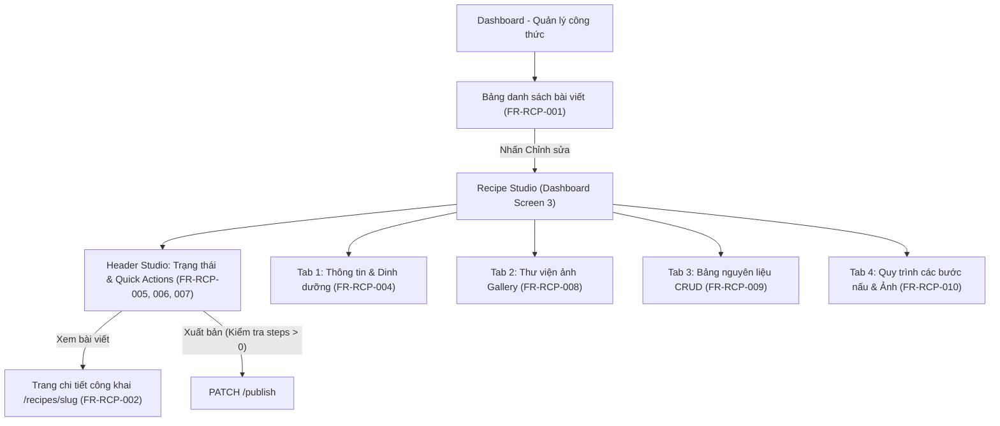

# Kế Hoạch Triển Khai Chi Tiết: Recipe Studio (Phương Án 2)
### Chuẩn Hóa Toàn Diện FR-RCP-001 Đến FR-RCP-010

---

## 1. Goal Description (Mục tiêu tổng quát)

Nâng cấp và hoàn thiện hệ thống quản trị công thức ẩm thực trong **Dashboard** theo mô hình **Recipe Studio (Quản trị theo Module chuyên biệt dạng Tab)** nhằm đáp ứng **100% các tiêu chí kỹ thuật và nghiệp vụ từ FR-RCP-001 đến FR-RCP-010** theo `SRS_Culinary_Blog_v1.0.0.md`.

### Các vấn đề cốt lõi cần giải quyết:
1. **Khắc phục triệt để lỗi logic ở FR-RCP-004:** Hiện tại API `UpdateRecipeCommand` không lưu `ingredients` và `steps`. Phương án 2 kết nối trực tiếp các thao tác sửa nguyên liệu và bước làm vào các REST API con chuyên biệt (`UpdateRecipeIngredientCommand`, `UpdateRecipeStepCommand`).
2. **Hiện thực hóa Thư viện ảnh FR-RCP-008:** Thay vì chỉ 1 ô nhập ảnh đại diện, xây dựng Thư viện ảnh (Gallery) kéo thả tải nhiều ảnh lên MinIO, đổi ảnh chính (`PATCH /primary`) và xóa ảnh lẻ (`DELETE /images/{id}`).
3. **Bảng quản trị Nguyên liệu FR-RCP-009:** Quản lý nguyên liệu độc lập tại chỗ (Thêm/Sửa/Xóa/Thứ tự `sortOrder`).
4. **Quy trình Các bước nấu FR-RCP-010:** Hỗ trợ tải ảnh minh họa cho từng bước làm (`imageUrl`), cài đặt đồng hồ hẹn giờ (`timerMinutes`), tự động đánh số lại khi xóa bước.
5. **Hoàn thiện Bộ lọc Dashboard FR-RCP-001 & Xử lý quyền hạn FR-RCP-002:** Bổ sung lọc thời gian nấu (`maxCookTime`), lọc độ khó, dropdown sắp xếp (`sortBy`), và xử lý trang 403/404 thân thiện cho bài viết Draft/Archived.



---

## 2. User Review Required (Các điểm cần lưu ý)

> [!IMPORTANT]
> **Tận dụng tối đa Backend hiện có:** Toàn bộ các API endpoints cho FR-RCP-008, FR-RCP-009, và FR-RCP-010 đã được xây dựng sẵn trong Backend (`RecipesEndpoints.cs`). Chúng ta không cần sửa đổi CSDL hay viết lại logic nghiệp vụ Backend, mà sẽ mở rộng Service & Hooks ở Frontend để kết nối trực tiếp và mượt mà.

> [!NOTE]
> **Trải nghiệm tác giả (Author UX):**
> - **Khi Tạo mới (Create):** Giữ form nhanh để tác giả tạo sườn bài viết ban đầu (Draft). Sau khi tạo thành công, hệ thống tự động chuyển vào **Recipe Studio** để tác giả tải thêm nhiều ảnh, điều chỉnh chi tiết nguyên liệu và thêm ảnh cho từng bước nếu muốn.
> - **Khi Chỉnh sửa (Edit):** Chia thành 4 Tab riêng biệt. Người dùng lưu thông tin nào thì chỉ cần lưu tab đó, không bao giờ bị mất dữ liệu hay xung đột phiên bản (Concurrency Conflict) không đáng có.

---

## 3. Open Questions (Câu hỏi mở)

*Hiện tại không có câu hỏi gây cản trở kỹ thuật do đặc tả SRS v1.0.0 đã quy định rất rõ ràng các trường dữ liệu và mã lỗi HTTP.*

---

## 4. Proposed Changes (Chi tiết các thay đổi theo từng thành phần)

---

### Component 1: Frontend Types, Services & React Query Hooks
Mở rộng các kiểu dữ liệu, các phương thức gọi API và các React Query hooks cho FR-RCP-008, FR-RCP-009, FR-RCP-010.

#### [MODIFY] `frontend/src/lib/types/recipe.ts`
- Thêm interface `AddRecipeIngredientRequest`, `UpdateRecipeIngredientRequest`
- Thêm interface `AddRecipeStepRequest`, `UpdateRecipeStepRequest`
- Đảm bảo kiểu dữ liệu khớp chính xác với DTOs của Backend.

```typescript
// Sub-resource request types
export interface AddRecipeIngredientRequest {
  name: string;
  quantity?: number | null;
  unit?: string | null;
  notes?: string | null;
  sortOrder?: number | null;
}

export interface UpdateRecipeIngredientRequest {
  name: string;
  quantity?: number | null;
  unit?: string | null;
  notes?: string | null;
  sortOrder?: number | null;
}

export interface AddRecipeStepRequest {
  title?: string;
  description: string;
  timerMinutes?: number | null;
  imageUrl?: string | null;
}

export interface UpdateRecipeStepRequest {
  title?: string;
  description: string;
  timerMinutes?: number | null;
  imageUrl?: string | null;
}
```

#### [MODIFY] `frontend/src/lib/services/recipe-service.ts`
Bổ sung các hàm gọi API REST:
- **FR-RCP-008 (Images):**
  - `uploadRecipeImage(recipeId: string, file: File, altText?: string): Promise<RecipeImageDto>` (`POST /recipes/{id}/images` với `multipart/form-data`)
  - `setPrimaryImage(recipeId: string, imageId: string): Promise<RecipeImageDto>` (`PATCH /recipes/{id}/images/{imageId}/primary`)
  - `deleteRecipeImage(recipeId: string, imageId: string): Promise<void>` (`DELETE /recipes/{id}/images/{imageId}`)
- **FR-RCP-009 (Ingredients):**
  - `addRecipeIngredient(recipeId: string, data: AddRecipeIngredientRequest): Promise<RecipeIngredientDto>` (`POST /recipes/{id}/ingredients`)
  - `updateRecipeIngredient(recipeId: string, ingredientId: string, data: UpdateRecipeIngredientRequest): Promise<RecipeIngredientDto>` (`PUT /recipes/{id}/ingredients/{ingredientId}`)
  - `deleteRecipeIngredient(recipeId: string, ingredientId: string): Promise<void>` (`DELETE /recipes/{id}/ingredients/{ingredientId}`)
- **FR-RCP-010 (Steps):**
  - `addRecipeStep(recipeId: string, data: AddRecipeStepRequest): Promise<RecipeStepDto>` (`POST /recipes/{id}/steps`)
  - `updateRecipeStep(recipeId: string, stepId: string, data: UpdateRecipeStepRequest): Promise<RecipeStepDto>` (`PUT /recipes/{id}/steps/{stepId}`)
  - `deleteRecipeStep(recipeId: string, stepId: string): Promise<void>` (`DELETE /recipes/{id}/steps/{stepId}`)

#### [MODIFY] `frontend/src/features/recipes/hooks.ts`
Thêm các React Query mutation hooks:
- `useUploadRecipeImage(recipeId: string)`
- `useSetPrimaryRecipeImage(recipeId: string)`
- `useDeleteRecipeImage(recipeId: string)`
- `useAddRecipeIngredient(recipeId: string)`
- `useUpdateRecipeIngredient(recipeId: string)`
- `useDeleteRecipeIngredient(recipeId: string)`
- `useAddRecipeStep(recipeId: string)`
- `useUpdateRecipeStep(recipeId: string)`
- `useDeleteRecipeStep(recipeId: string)`
*(Tất cả đều tự động `invalidateQueries` cho `recipeKeys.detail(slug)` để UI tự làm mới ngay lập tức).*

---

### Component 2: Recipe Studio Tabs & Header Components (Dashboard)
Xây dựng cụm component chuyên sâu cho Dashboard Studio.

#### [NEW] `frontend/src/components/dashboard/studio/RecipeStudioHeader.tsx`
- **Breadcrumb & Quay lại:** Nút quay lại danh sách bài viết.
- **Trạng thái & Huy hiệu:** Nhãn `Bản nháp`, `Đã xuất bản`, `Kho lưu trữ`.
- **Hành động nghiệp vụ thông minh:**
  - Nút **"Xem bài viết"**: Mở xem chi tiết trang công khai `/recipes/[slug]` trong tab mới.
  - Nút **"Xuất bản" (Publish):**
    - Kiểm tra điều kiện: Nếu `steps.length === 0`, hiển thị Tooltip cảnh báo *"Theo quy định FR-RCP-005, công thức cần ít nhất 1 bước thực hiện để được xuất bản"* và disable nút hoặc nhắc nhở trước khi gọi API.
  - Nút **"Hủy xuất bản" (Unpublish):** Hiển thị khi bài đang ở trạng thái Published.
  - Nút **"Lưu trữ" (Archive):** Chuyển bài vào kho lưu trữ.
  - Nút **"Xóa" (Delete):** Mở modal xác nhận xóa vĩnh viễn (FR-RCP-007).

#### [NEW] `frontend/src/components/dashboard/studio/tabs/StudioGeneralTab.tsx` (FR-RCP-004)
- Form quản lý thông tin cốt lõi:
  - Tiêu đề món ăn, Mô tả giới thiệu, Hướng dẫn tổng quát.
  - Danh mục món ăn (Dropdown lấy từ API Categories).
  - Thời gian chuẩn bị, Thời gian nấu, Khẩu phần, Độ khó (Dễ, Trung bình, Khó).
  - Khối dinh dưỡng: Calories, Protein, Carbs, Fat.
- Concurrency Check: Gửi kèm `rowVersionBase64`. Nếu phát hiện mã lỗi 409 Conflict, hiển thị thông báo thân thiện và nút "Tải lại dữ liệu mới nhất".

#### [NEW] `frontend/src/components/dashboard/studio/tabs/StudioGalleryTab.tsx` (FR-RCP-008)
- Khu vực kéo thả / chọn file tải ảnh lên MinIO qua `POST /recipes/{id}/images`.
- Kiểm tra dung lượng (Max 5MB) và định dạng ảnh (JPEG, PNG, WebP) tại client.
- Lưới hiển thị danh sách tất cả ảnh trong `recipe.images`:
  - Thẻ ảnh kích thước lớn, sắc nét.
  - Huy hiệu `[Ảnh đại diện]` viền vàng nổi bật nếu `img.isPrimary === true`.
  - Nút bấm `[Đặt làm ảnh chính]` cho các ảnh phụ (gọi `PATCH /primary`).
  - Nút bấm `[Xóa ảnh]` với modal xác nhận nhanh (gọi `DELETE /images/{id}`).

#### [NEW] `frontend/src/components/dashboard/studio/tabs/StudioIngredientsTab.tsx` (FR-RCP-009)
- Bảng hiển thị danh sách nguyên liệu trực quan:
  - Cột: Tên nguyên liệu, Số lượng, Đơn vị, Ghi chú, Thứ tự hiển thị (`sortOrder`), Thao tác.
- Nút **"Thêm nguyên liệu mới"**: Mở thanh nhập nhanh / modal với các trường:
  - Tên (Bắt buộc, tối đa 100 ký tự)
  - Số lượng (> 0)
  - Đơn vị tính (g, ml, muỗng...)
  - Ghi chú (tùy chọn)
  - Thứ tự hiển thị (`sortOrder`)
- Chế độ **Chỉnh sửa tại chỗ (Inline Edit)** hoặc Modal: Cho phép cập nhật từng nguyên liệu độc lập mà không ảnh hưởng tới toàn bài viết.
- Nút **Xóa nguyên liệu**: Gọi API xóa độc lập, cập nhật lại bảng ngay tức thì.

#### [NEW] `frontend/src/components/dashboard/studio/tabs/StudioStepsTab.tsx` (FR-RCP-010)
- Danh sách các bước làm trực quan theo trình tự thời gian (Bước 1, Bước 2...).
- Mỗi thẻ bước bao gồm:
  - Số thứ tự tự động (`StepNumber`).
  - Tiêu đề bước (tùy chọn) & Nội dung hướng dẫn chi tiết (tối đa 2000 ký tự).
  - Đồng hồ hẹn giờ nấu (`timerMinutes`) kèm biểu tượng Clock.
  - **Ảnh minh họa cho bước (`imageUrl`):** Tích hợp nút upload ảnh hoặc dán URL ảnh trực tiếp cho từng bước!
- Nút **"Thêm bước tiếp theo"**: Tự động sinh `StepNumber = Max + 1`.
- Nút **Chỉnh sửa bước**: Cập nhật nội dung, thời gian và ảnh của bước.
- Nút **Xóa bước**: Xóa bước và Backend tự động đánh số lại các bước còn lại theo quy tắc của FR-RCP-010.

#### [MODIFY] `frontend/src/components/dashboard/views/DashboardRecipeEditView.tsx`
- Tích hợp `RecipeStudioHeader` và 4 Tab:
  - `general`: Thông tin chung & Dinh dưỡng
  - `gallery`: Thư viện ảnh MinIO (Gallery & Primary)
  - `ingredients`: Bảng nguyên liệu
  - `steps`: Quy trình các bước nấu
- Quản lý state activeTab mượt mà, lưu tab đang chọn lên URL search params để khi F5 tải lại trang không bị mất vị trí đang làm việc.

---

### Component 3: Nâng Cấp Bảng Danh Sách Trong Dashboard (FR-RCP-001)

#### [MODIFY] `frontend/src/components/dashboard/views/DashboardRecipesView.tsx`
- **Bổ sung bộ lọc thời gian nấu (`maxCookTime`):**
  - Thêm dropdown/slider: Tất cả, Dưới 15 phút, Dưới 30 phút, Dưới 60 phút, Trên 60 phút.
- **Bổ sung bộ lọc độ khó (`difficulty`):**
  - Tất cả, Dễ (0), Trung bình (1), Khó (2).
- **Bổ sung Dropdown sắp xếp (`sortBy`):**
  - Mới nhất (`newest`), Cũ nhất (`oldest`), Nấu nhanh nhất (`time_asc`), Nấu lâu nhất (`time_desc`).
- **Nút Xóa bộ lọc (Reset):** Hiển thị khi người dùng đang có bộ lọc hoạt động, click vào đưa tất cả về mặc định trong 1 click.
- **Empty State thông minh:** Nếu tìm kiếm không thấy bài nào, hiển thị nút "Xóa từ khóa tìm kiếm" để quay lại danh sách đầy đủ.

---

### Component 4: Xử Lý Quyền Hạn Thân Thiện Trang Chi Tiết (FR-RCP-002)

#### [MODIFY] `frontend/src/app/recipes/[slug]/page.tsx` & `RecipeDetailView.tsx`
- Khi API trả về `403 Forbidden` hoặc `404 Not Found` (Ví dụ Guest truy cập vào slug bài Draft hoặc Archived):
  - Hiển thị giao diện thông báo lịch sự, trang nhã: *"Công thức này hiện đang ở chế độ bản nháp hoặc đã được lưu trữ bởi tác giả."*
  - Nút điều hướng *"Khám phá các công thức khác"* đưa người dùng về trang `/recipes` an toàn, không bị văng lỗi hay hiện màn hình xám khó hiểu.

---

## 5. Verification Plan (Kế hoạch kiểm thử & nghiệm thu)

### Automated Tests (Kiểm thử tự động)
Chạy kiểm thử toàn bộ Backend Unit & Integration Tests để đảm bảo không phát sinh regression:
```powershell
dotnet test backend/tests/CulinaryBlog.Application.Tests/CulinaryBlog.Application.Tests.csproj
```
Kiểm tra type checking và build của Frontend Next.js:
```powershell
npm --prefix frontend run build
```

### Manual Verification (Kịch bản kiểm thử thủ công từng trường hợp)

1. **Kiểm tra FR-RCP-001 (Lọc & Sắp xếp Dashboard):**
   - Đăng nhập vào Dashboard.
   - Chọn bộ lọc Thời gian nấu (vd: < 30 phút), kiểm tra danh sách có thu hẹp đúng không.
   - Chọn Sắp xếp theo "Mới nhất" và "Thời gian nấu tăng dần".
   - Bấm nút "Xóa bộ lọc" để xác nhận danh sách trở lại ban đầu.

2. **Kiểm tra FR-RCP-004 (Cập nhật thông tin chung):**
   - Vào chỉnh sửa một bài viết tại Tab "Thông tin chung".
   - Sửa tiêu đề và thời gian nấu -> Bấm "Lưu thông tin".
   - Kiểm tra thông báo thành công và dữ liệu được cập nhật chính xác.

3. **Kiểm tra FR-RCP-008 (Thư viện ảnh Gallery & Đặt ảnh chính):**
   - Chuyển sang Tab "Thư viện ảnh".
   - Tải lên 2 ảnh mới vào bài viết.
   - Nhấn "Đặt làm ảnh chính" ở ảnh thứ 2 -> Xác nhận huy hiệu "Ảnh đại diện" chuyển sang ảnh thứ 2.
   - Nhấn "Xóa ảnh" ở ảnh thứ 1 -> Xác nhận ảnh bị xóa khỏi thư viện.

4. **Kiểm tra FR-RCP-009 (Bảng nguyên liệu CRUD):**
   - Chuyển sang Tab "Nguyên liệu".
   - Thêm 1 nguyên liệu mới: "Nước mắm", 20, "ml", ghi chú: "loại ngon", thứ tự: 1.
   - Sửa định lượng thành 30ml -> Kiểm tra dữ liệu lưu thành công.
   - Xóa 1 nguyên liệu -> Xác nhận dòng đó biến mất khỏi bảng.

5. **Kiểm tra FR-RCP-010 (Quy trình các bước nấu & Ảnh bước):**
   - Chuyển sang Tab "Các bước nấu".
   - Thêm bước mới kèm thời gian hẹn giờ 15 phút và tải ảnh minh họa của bước đó.
   - Xóa bước 1 -> Kiểm tra bước 2 tự động được đánh số lại thành Bước 1.

6. **Kiểm tra FR-RCP-005 (Điều kiện xuất bản):**
   - Tạo một công thức mới không có bước làm nào (Steps = 0).
   - Kiểm tra nút "Xuất bản" trên Header Studio có cảnh báo ngăn chặn hoặc thông báo rõ lý do không thể xuất bản hay không.

7. **Kiểm tra FR-RCP-002 (Truy cập bài Draft):**
   - Dùng trình duyệt ẩn danh (Guest) truy cập trực tiếp URL của một bài viết đang là Draft.
   - Xác nhận trang hiển thị thông báo "Bài viết đang ở chế độ bản nháp" thân thiện và có nút quay về trang chủ.
